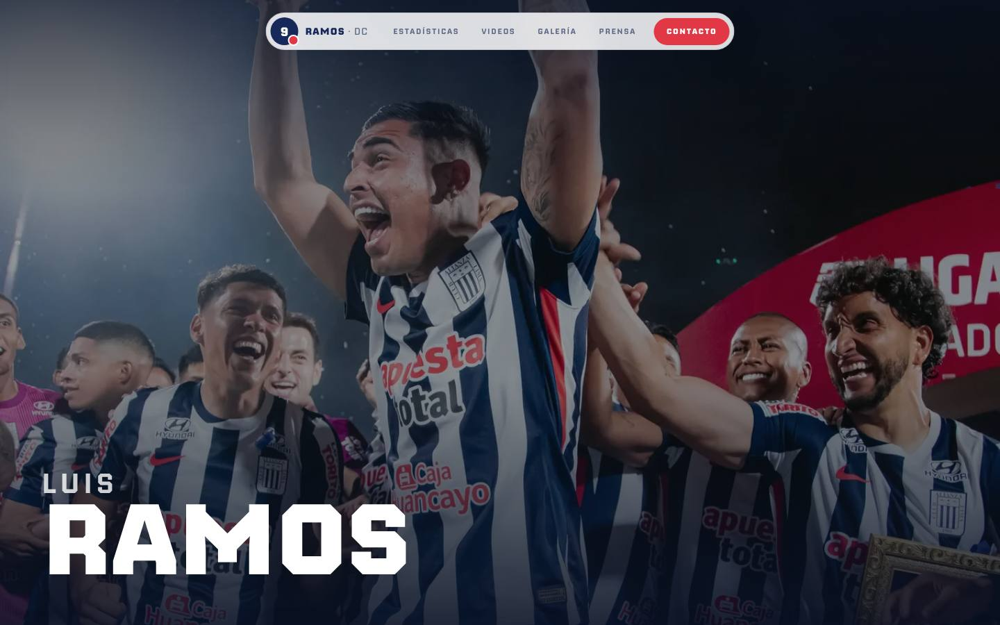
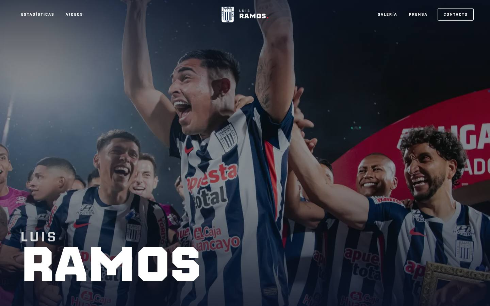
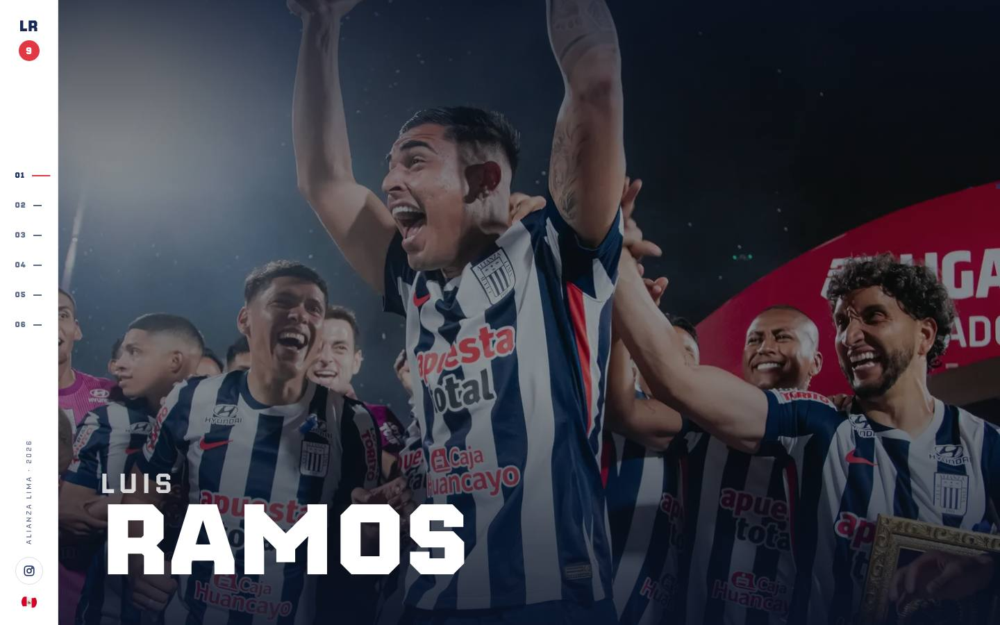
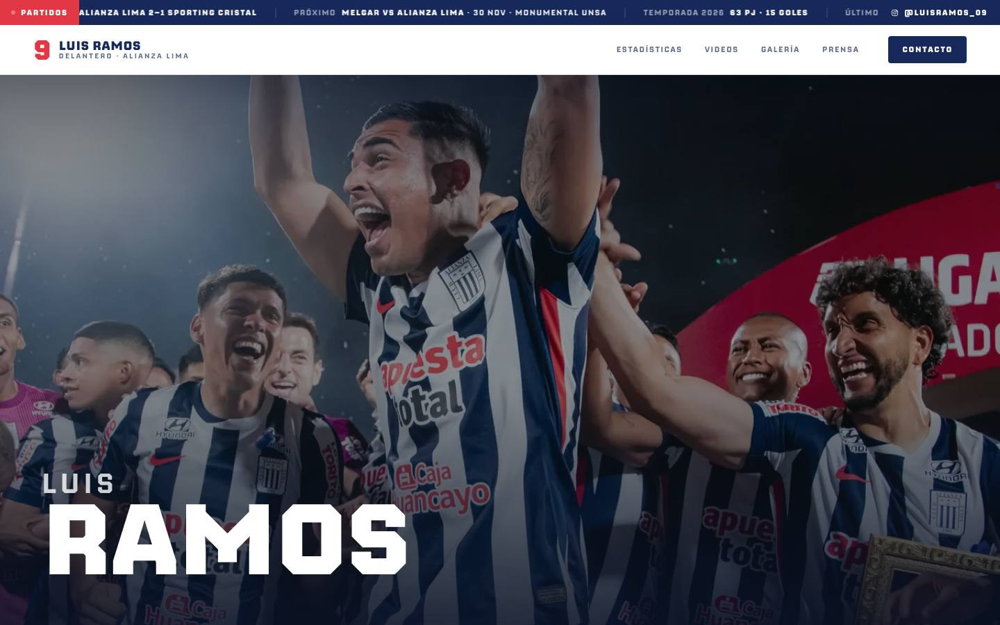
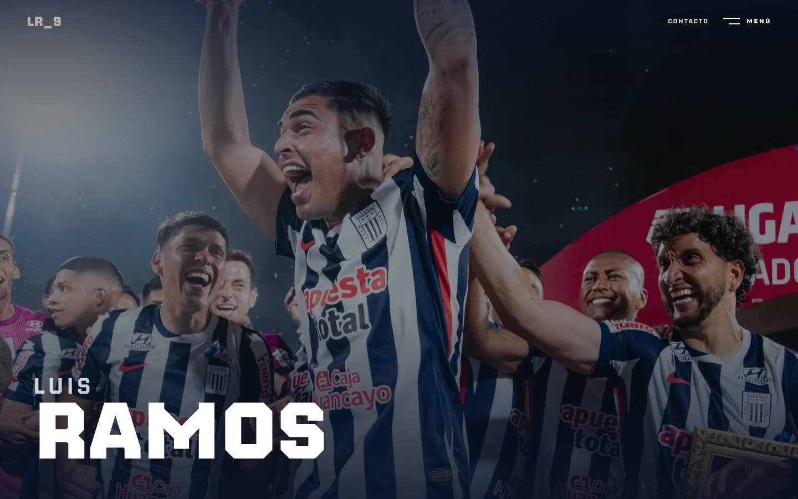

# Navbar

Cinco opciones del **kit claro** (diseñadas para Luis Ramos), en paleta clara con el azul del club como acento, el rojo como segundo acento y tipografía Nippo. Salen de [`kits/claro`](../../kits/claro/): los datos del jugador están en `player.js` y se regeneran para otro jugador con `herramientas/previews/empaquetar.mjs`.

Cada preview trae debajo un hero y secciones de relleno para probar el estado al bajar y la sección activa. Con `#open` al final de la URL, el menú arranca abierto; el comparador lo usa para mostrar el menú en mobile.

| # | Modelo | Estado | Preview |
|---|---|---|---|
| C1 | Cápsula con dorsal | Alternativa | [html](previews/claro-1-capsula.html) ·  |
| C2 | Escudo al centro | Alternativa | [html](previews/claro-2-escudo.html) ·  |
| C3 | Riel lateral | Alternativa | [html](previews/claro-3-riel.html) ·  |
| C4 | Zócalo de partido | Alternativa | [html](previews/claro-4-zocalo.html) ·  |
| C5 | **Índice a pantalla completa** | ✅ Aplicado en Luis Ramos | [html](previews/claro-5-indice.html) ·  |

- **C1. Cápsula con dorsal:** cápsula flotante translúcida. A la izquierda va el dorsal en un círculo con el apellido y la posición; al centro, los links, con una píldora que se desliza hasta la sección activa; a la derecha, Contacto en el segundo acento. Se esconde al bajar y vuelve al subir. En mobile, el menú es una hoja que sube desde abajo.
- **C2. Escudo al centro:** barra a todo el ancho con el escudo y el nombre al centro y los links repartidos a los lados. Es transparente sobre el hero y, al pasarlo, se vuelve blanca y aparece una línea de los dos colores abajo. En mobile, un cajón lateral del acento con el dorsal gigante de fondo.
- **C3. Riel lateral:** riel vertical fijo a la izquierda (84 px) con un índice numerado; al pasar el mouse aparece el nombre de la sección. Obliga a correr el contenido con `padding-left`. En mobile, cabecera mínima arriba y barra de secciones abajo, tipo app.
- **C4. Zócalo de partido:** franja del acento arriba con el último resultado, el próximo partido y la temporada en loop, y debajo la barra blanca. Al bajar, la franja se esconde. En mobile, el menú se despliega en grilla con una tarjeta de partidos. En React, los partidos salen de `useMatches`.
- **C5. Índice a pantalla completa (aplicado en Luis Ramos):** barra mínima (iniciales + dorsal, Contacto y MENÚ) con `mix-blend-mode: difference`, así se lee sobre fondos claros y oscuros. El menú abre a pantalla completa con una cortina del acento, los links gigantes numerados (la sección activa va en contorno), los contactos y el retrato.
  - **React:** [`react/NavbarIndex.jsx`](react/NavbarIndex.jsx). Usa Chakra y framer-motion, frena Lenis (`window.__lenis`) mientras está abierto, se cierra con Escape y marca la sección activa con IntersectionObserver.
  - **Datos de `playerData`:** `initials`, `number`, `displayName`, `name`, `fullName`, `position`, `logoCurrentClub`, `currentClub`, `contact` (title, label, url), `socialMedia` (Instagram) y los nuevos `menuPortrait` y `menuPortraitAlt`. El retrato conviene en vertical, de unos 1200 px.
  - **Tema:** `brand.amber` (acento: cortina y links), `brand.dorado` (números y hover) y `brand.gray`.
  - Revisá que los `href` de `navLinks` coincidan con los `id` de las secciones.
