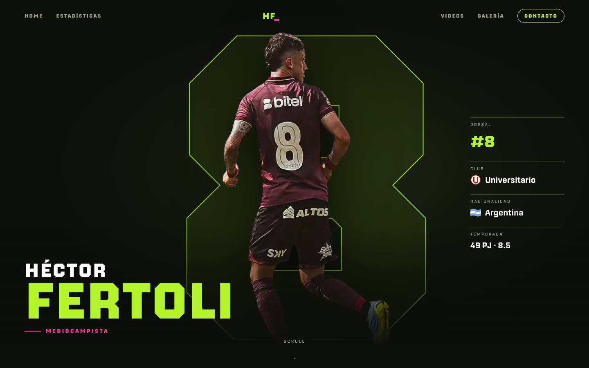
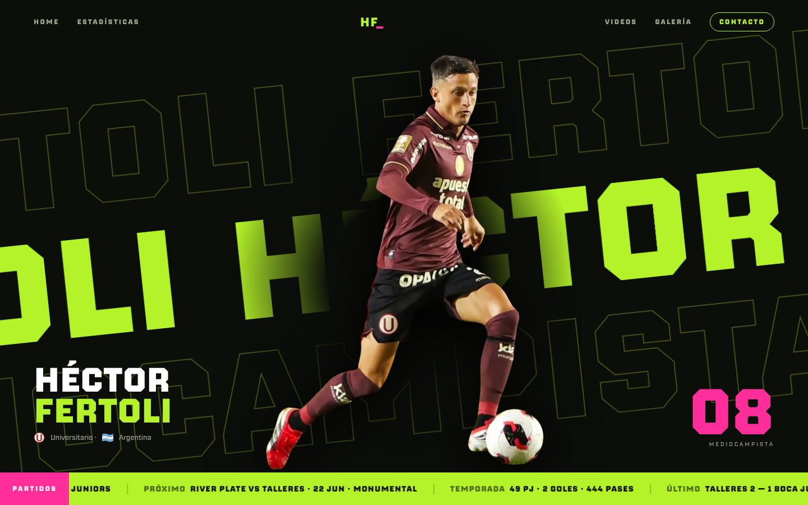
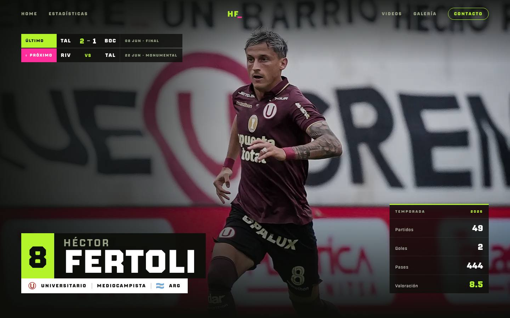

# Hero

## Modelo aplicado: Hero con recorte y scroll animado

**Archivos del starter:** `src/components/Hero/Hero.jsx` y `MatchBox.jsx`, `src/utils/heroUnits.js` y `src/hooks/useMatches.js`.

**Qué tiene**
- Apellido gigante en el acento y nombre en crema. Es el único `h1` de la página.
- Dorsal en contorno, posición, nacionalidad con bandera y club actual con escudo.
- Recorte PNG del jugador, de cuerpo entero, con `fetchpriority="high"` porque es la imagen principal de la página.
- Dos fotos de fondo. La segunda (`hero-bg2`) solo se ve en desktop, a la derecha.
- **MatchBox:** pestaña lateral "Partidos" con los próximos partidos. Los carga Firebase desde `/admin` y, si no está configurado, usa `matchData.js`.
- La sección mide `200svh` y su contenido queda fijo (`sticky`) mientras GSAP anima la salida con el scroll.

**Decisiones técnicas que conviene conservar**
- **Textos que no cambian con el zoom:** se usa la unidad `--hu`, basada en vw y calculada para 390, 820 y 1440 px de referencia, con la función `u(n)`. Así el hero se ve igual con el navegador al 80 % o al 125 %.
- **Alto estable en mobile:** `--sv` vale `1svh` (con `1vh` como respaldo). Antes se usaba `100dvh` y el hero cambiaba de tamaño al aparecer y desaparecer la barra del navegador.
  - `main.jsx` además configura `ScrollTrigger.config({ ignoreMobileResize: true })`.
  - La sección que se superpone después del hero usa `margin-top: -100svh`.
- **Celular horizontal:** `LANDSCAPE` cambia la referencia a `--sv` para que el hero entre en pantalla.

**Para adaptar**
- **Datos:** `name`, `fullName`, `number`, `position`, `nationality`, `nationalityFlag`, `currentClub`, `logoCurrentClub` e `image` en `playerData.js`.
- **Recorte:** cada recorte tiene otras proporciones. Hay que ajustar el `left`, el `h` y el `objectPosition` de la imagen del jugador y revisarlo en 390, 820 y 1440 px.

## Kit neón (diseñado para Héctor Fertoli)

Cuatro opciones más, en paleta oscura con acento lima y magenta y tipografía Nippo. Salen de [`kits/neon`](../../kits/neon/): los datos del jugador están en `player.js`, así que se pueden regenerar con otro jugador (ver el [README del kit](../../kits/neon/README.md)).

| # | Modelo | Estado | Preview |
|---|---|---|---|
| N1 | Dorsal gigante | Alternativa | [html](previews/neon-1-dorsal.html) ·  |
| N2 | Split editorial | Alternativa | [html](previews/neon-2-split.html) ·  |
| N3 | Marquesina | Alternativa | [html](previews/neon-3-marquesina.html) ·  |
| N4 | **Transmisión TV** | ✅ Aplicado en Héctor Fertoli | [html](previews/neon-4-transmision.html) ·  |

- **N1. Dorsal gigante:** el dorsal en contorno ocupa toda la altura y el jugador aparece de espaldas con el mismo número. Nombre abajo a la izquierda y una ficha a la derecha (dorsal, club, nacionalidad, temporada). Necesita un recorte de espaldas donde se lea el número.
- **N2. Split editorial:** texto, bio corta, 4 datos y dos botones ("Ver jugadas" y "Contacto") a la izquierda; a la derecha un panel del acento en diagonal con el recorte saliendo de él. Es el más comercial.
- **N3. Marquesina:** tres bandas inclinadas con apellido, nombre completo y posición que corren en sentidos opuestos detrás del recorte. Abajo, un zócalo tipo TV con el último resultado, el próximo partido y la temporada, en loop. Reemplaza a la MatchBox.
- **N4. Transmisión TV (aplicado en Fertoli):** foto de cancha a todo el ancho con gráficos de transmisión: arriba a la izquierda un marcador de dos filas (último resultado y próximo partido), abajo el zócalo con el dorsal, el nombre y el club, y abajo a la derecha el cuadro de la temporada.
  - **React:** [`react/HeroBroadcast.jsx`](react/HeroBroadcast.jsx). Usa `useMatches` del starter (panel `/admin`) para los partidos, y si un equipo no tiene escudo muestra la sigla.
  - **Datos extra en `playerData`:** `heroPhoto` (foto horizontal o vertical de alta resolución) y `heroPhotoAlt`, además de `displayName`, `seasonShort` y `seasonStats`.
  - **Foto:** con una foto vertical, en escritorio a todo el ancho entra de la cabeza a los muslos; para ver el cuerpo entero hace falta una foto horizontal con el jugador más chico en el cuadro. Recortar desde arriba de la cabeza y exportar en alta (mínimo 1600 px de ancho).
