# Hero

## Modelo aplicado: Hero con recorte y scroll animado

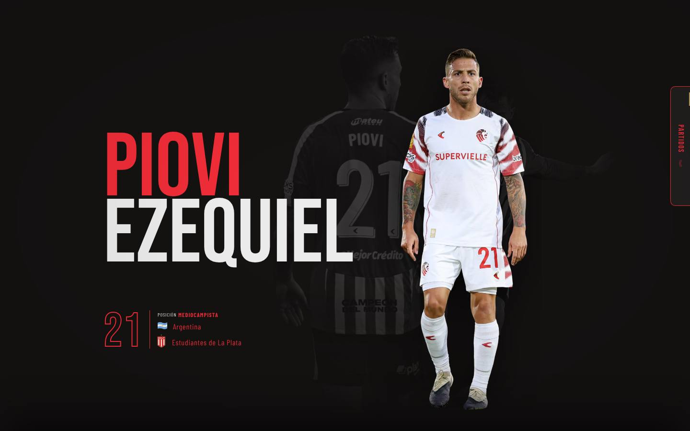

**Archivos del starter:** `src/components/Hero/Hero.jsx` y `MatchBox.jsx`, `src/utils/heroUnits.js` y `src/hooks/useMatches.js`.

**Qué tiene**
- Apellido gigante en el acento y nombre en crema. Es el único `h1` de la página.
- Dorsal en contorno, posición, nacionalidad con bandera y club actual con escudo.
- Recorte PNG del jugador, de cuerpo entero, con `fetchpriority="high"` porque es la imagen principal de la página.
- Dos fotos de fondo. La segunda (`hero-bg2`) solo se ve en desktop, a la derecha.
- **MatchBox:** pestaña lateral "Partidos" con los próximos partidos. Los carga Firebase desde `/admin` y, si no está configurado, usa `matchData.js`.
- La sección mide `200svh` y su contenido queda fijo (`sticky`) mientras GSAP anima la salida con el scroll.

**Decisiones técnicas que conviene conservar**
- **Textos que no cambian con el zoom:** se usa la unidad `--hu`, basada en vw y calculada para 390, 820 y 1440 px de referencia, con la función `u(n)`. Así el hero se ve igual con el navegador al 80 % o al 125 %.
- **Alto estable en mobile:** `--sv` vale `1svh` (con `1vh` como respaldo). Antes se usaba `100dvh` y el hero cambiaba de tamaño al aparecer y desaparecer la barra del navegador.
  - `main.jsx` además configura `ScrollTrigger.config({ ignoreMobileResize: true })`.
  - La sección que se superpone después del hero usa `margin-top: -100svh`.
- **Celular horizontal:** `LANDSCAPE` cambia la referencia a `--sv` para que el hero entre en pantalla.

**Para adaptar**
- **Datos:** `name`, `fullName`, `number`, `position`, `nationality`, `nationalityFlag`, `currentClub`, `logoCurrentClub` e `image` en `playerData.js`.
- **Recorte:** cada recorte tiene otras proporciones. Hay que ajustar el `left`, el `h` y el `objectPosition` de la imagen del jugador y revisarlo en 390, 820 y 1440 px.

## Kit neón (diseñado para Héctor Fertoli)

Cuatro opciones más, en paleta oscura con acento lima y magenta y tipografía Nippo. Salen de [`kits/neon`](../../kits/neon/): los datos del jugador están en `player.js`, así que se pueden regenerar con otro jugador (ver el [README del kit](../../kits/neon/README.md)).

| # | Modelo | Estado | Preview |
|---|---|---|---|
| N1 | Dorsal gigante | Alternativa | [html](previews/neon-1-dorsal.html) ·  |
| N2 | Split editorial | Alternativa | [html](previews/neon-2-split.html) · 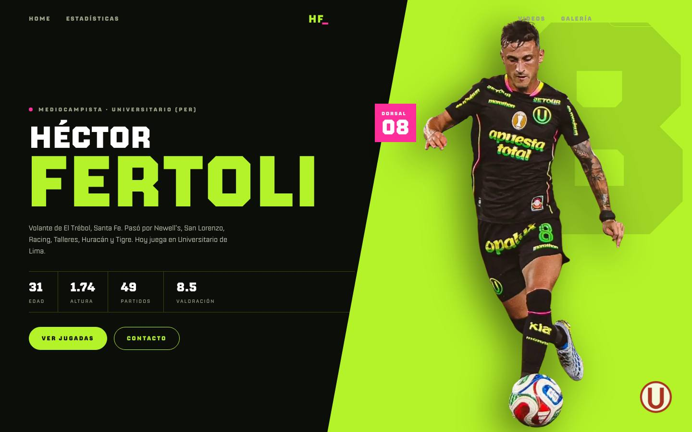 |
| N3 | Marquesina | Alternativa | [html](previews/neon-3-marquesina.html) ·  |
| N4 | **Transmisión TV** | ✅ Aplicado en Héctor Fertoli | [html](previews/neon-4-transmision.html) ·  |

- **N1. Dorsal gigante:** el dorsal en contorno ocupa toda la altura y el jugador aparece de espaldas con el mismo número. Nombre abajo a la izquierda y una ficha a la derecha (dorsal, club, nacionalidad, temporada). Necesita un recorte de espaldas donde se lea el número.
- **N2. Split editorial:** texto, bio corta, 4 datos y dos botones ("Ver jugadas" y "Contacto") a la izquierda; a la derecha un panel del acento en diagonal con el recorte saliendo de él. Es el más comercial.
- **N3. Marquesina:** tres bandas inclinadas con apellido, nombre completo y posición que corren en sentidos opuestos detrás del recorte. Abajo, un zócalo tipo TV con el último resultado, el próximo partido y la temporada, en loop. Reemplaza a la MatchBox.
- **N4. Transmisión TV (aplicado en Fertoli):** foto de cancha a todo el ancho con gráficos de transmisión: arriba a la izquierda un marcador de dos filas (último resultado y próximo partido), abajo el zócalo con el dorsal, el nombre y el club, y abajo a la derecha el cuadro de la temporada.
  - **React:** [`react/HeroBroadcast.jsx`](react/HeroBroadcast.jsx). Usa `useMatches` del starter (panel `/admin`) para los partidos, y si un equipo no tiene escudo muestra la sigla.
  - **Datos extra en `playerData`:** `heroPhoto` (foto horizontal o vertical de alta resolución) y `heroPhotoAlt`, además de `displayName`, `seasonShort` y `seasonStats`.
  - **Foto:** con una foto vertical, en escritorio a todo el ancho entra de la cabeza a los muslos; para ver el cuerpo entero hace falta una foto horizontal con el jugador más chico en el cuadro. Recortar desde arriba de la cabeza y exportar en alta (mínimo 1600 px de ancho).

## MatchBox: último resultado y próximo partido (diseñado para Polaco Fydriszewski)

Tres formas de mostrar los partidos dentro del hero. Las tres usan `useMatches` del starter (panel `/admin` con Firebase, o `matchData.js` si no está configurado) y, si un equipo no tiene escudo, muestran su sigla en un círculo.

**React:** [`react/MatchBox.jsx`](react/MatchBox.jsx) exporta `MatchTicker`, `MatchCard` y `MatchTickets`. Todas reciben `last` y `next`. Los colores están en la constante `C` al principio del archivo: cambiá esos valores por los del club o por tokens del theme.

| # | Modelo | Estado | Desktop | Mobile |
|---|---|---|---|---|
| M1 | **Marcador de TV** | ✅ Aplicado en Polaco Fydriszewski | 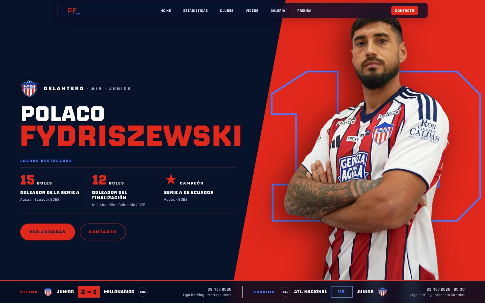 | 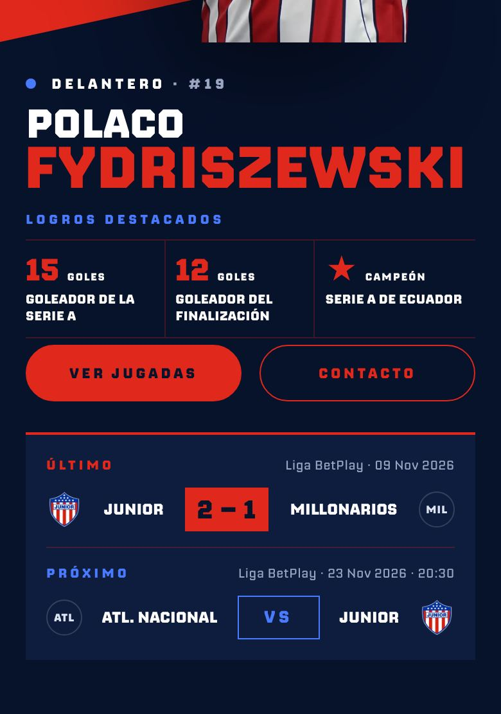 |
| M2 | Tarjeta con pestañas | Alternativa | 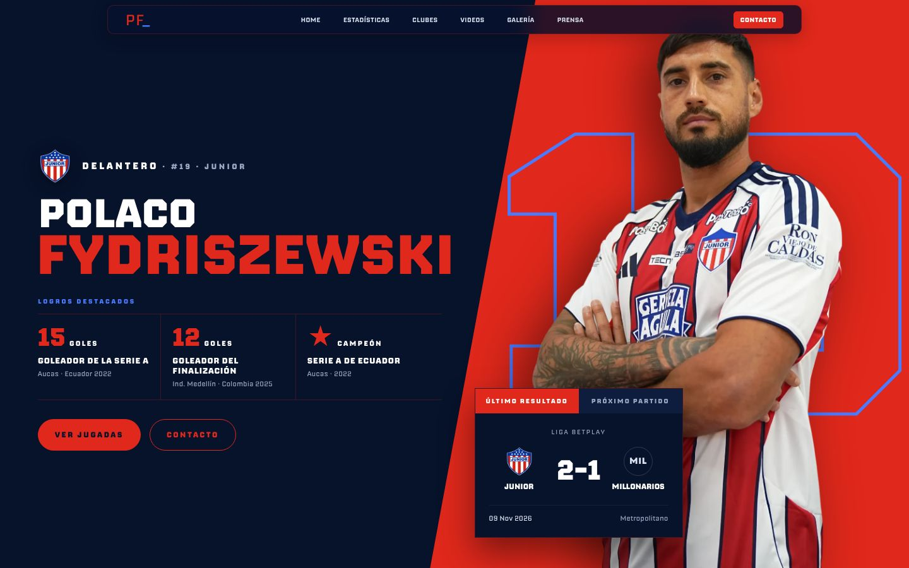 | 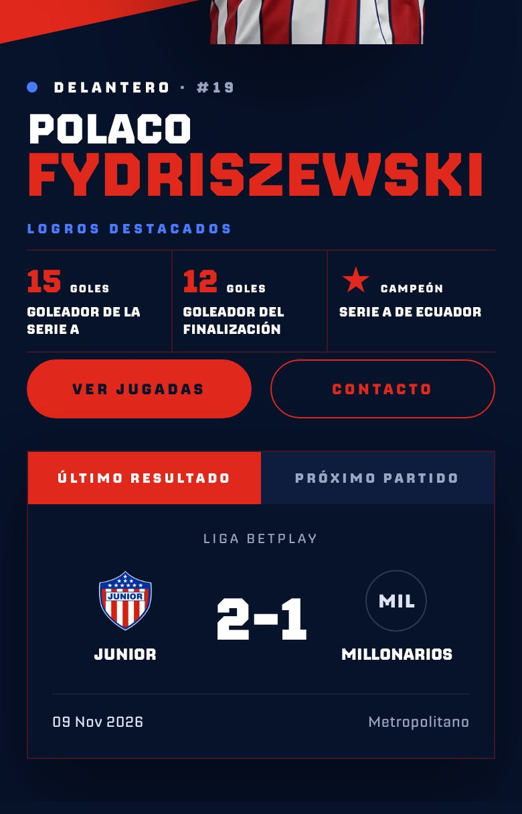 |
| M3 | Dos tickets | Alternativa | 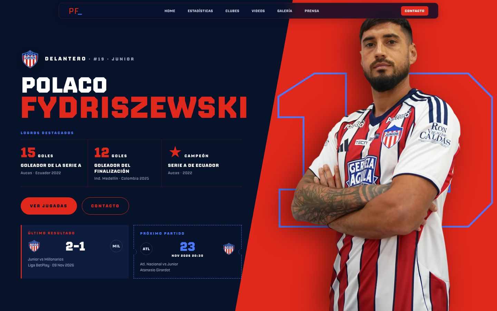 | 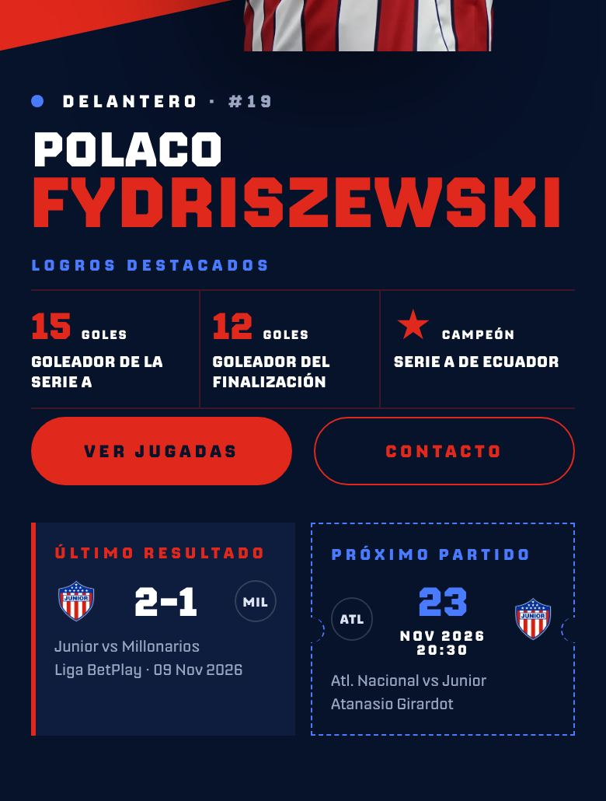 |

- **M1. Marcador de TV (`MatchTicker`):** en desktop es una barra pegada abajo del hero, como el zócalo de una transmisión. A la izquierda va el último resultado, con el marcador en un bloque del acento. A la derecha va el próximo partido, con "VS" en contorno. Desde 1280 px suma la fecha, la competencia y el estadio. En mobile va debajo de los botones, con los dos partidos apilados y la fecha arriba de cada uno.
  - El hero tiene que dejarle lugar. En Polaco, la columna de texto lleva `pb: 120px` en desktop y la sección usa `minH: max(700px, 100svh)` con `h: auto`, así crece en pantallas bajas en vez de pisar los botones.
  - Montaje: un `Box` con `position="absolute" left={0} right={0} bottom={0}` dentro de la sección para desktop (`display={{ base: 'none', lg: 'block' }}`), y otro dentro del flujo del texto para mobile.
- **M2. Tarjeta con pestañas (`MatchCard`):** tarjeta de 330 px con dos pestañas, "Último resultado" (acento) y "Próximo partido" (segundo acento). Muestra un partido a la vez, con escudos grandes y marcador o "VS" al centro, y abajo la fecha y el estadio. En Polaco se probó flotando sobre el panel del recorte (`left: 2%`, `bottom: 48px`). Conviene cuando el texto del hero ya está cargado y no hay lugar abajo. En mobile va a todo el ancho.
- **M3. Dos tickets (`MatchTickets`):** dos piezas lado a lado debajo de los botones. El resultado es un marcador con borde izquierdo del acento. El próximo partido es una "entrada" con borde punteado y perforaciones laterales, con el día grande y el mes y la hora debajo (toma el primer token de `date` como día). Se ve igual en desktop y mobile. Ocupa alto en la columna de texto, así que el hero tiene que tener lugar.

## Kit claro (diseñado para Luis Ramos)

Seis opciones en paleta clara (blanco, azul del club y rojo) con tipografía Nippo, desde [`kits/claro`](../../kits/claro/). Las 1 a 3 son las del kit neón adaptadas; la 4, la 5 y la 6 son nuevas.

| # | Modelo | Estado | Preview |
|---|---|---|---|
| C1 | Split editorial | Alternativa | [html](previews/claro-1-split.html) · 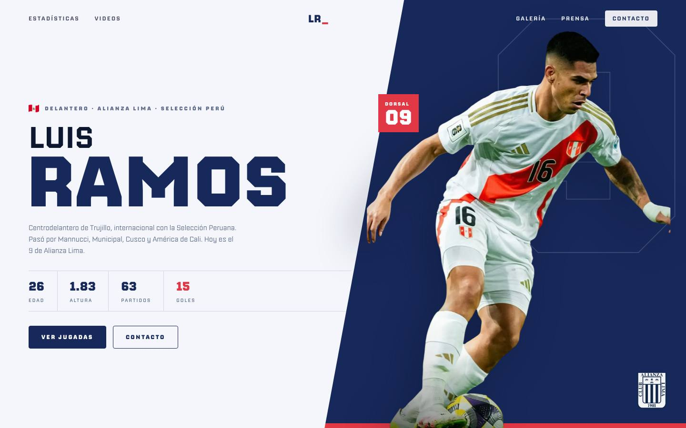 |
| C2 | Marquesina | Alternativa | [html](previews/claro-2-marquesina.html) · 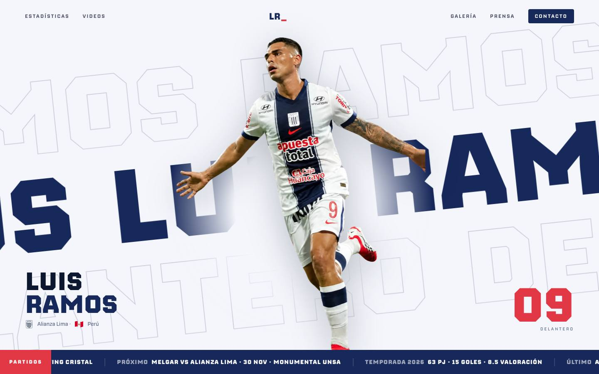 |
| C3 | Transmisión TV | Alternativa (React en `react/HeroBroadcast.jsx`) | [html](previews/claro-3-transmision.html) · 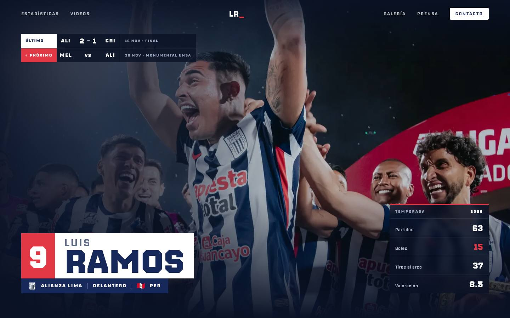 |
| C4 | Franjas del club | Alternativa | [html](previews/claro-4-franjas.html) · 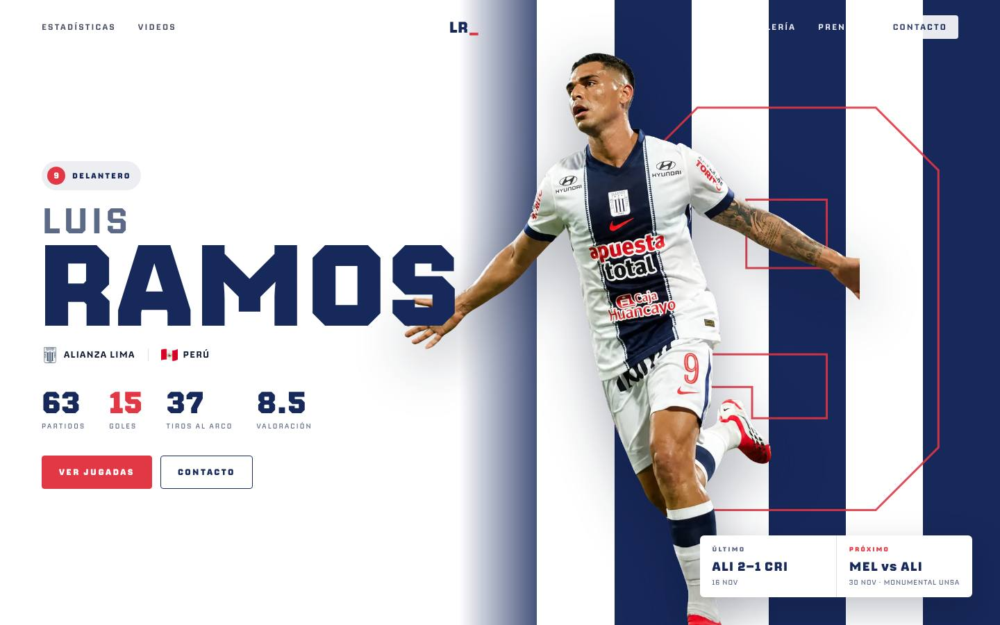 |
| C5 | Portada de revista | Alternativa | [html](previews/claro-5-portada.html) · 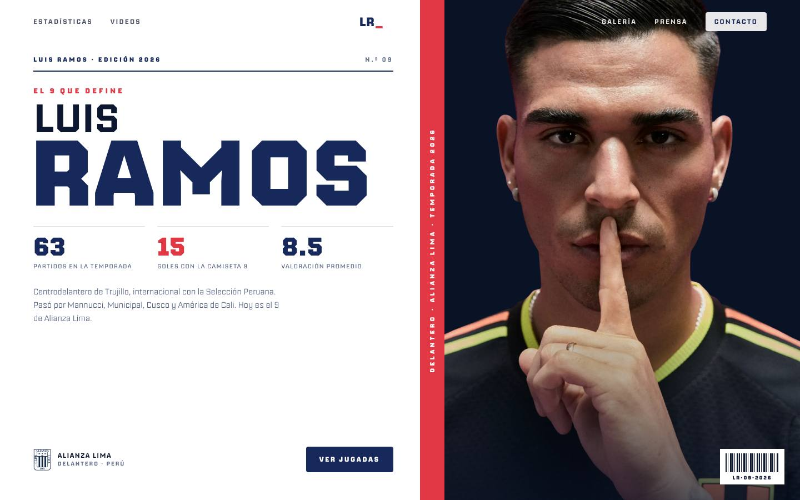 |
| C6 | **Split con ficha** | ✅ Aplicado en Luis Ramos | [html](previews/claro-6-split-ficha.html) · 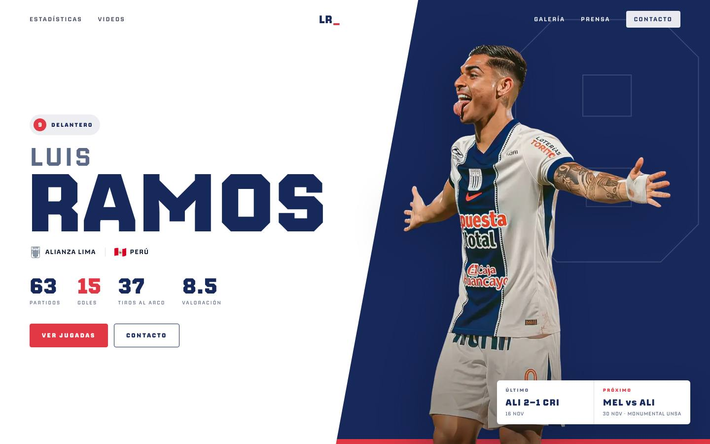 |

- **C4. Franjas del club:** las franjas verticales de la camiseta entran desde arriba, una por una, con el dorsal gigante en contorno del segundo acento y el recorte adelante. A la izquierda, píldora con dorsal y posición, nombre, club y selección, 4 números y botones; abajo a la derecha, una tarjeta con los dos partidos. Ideal para clubes con camiseta a bastones.
- **C5. Portada de revista:** cabecera "Edición <año> · N.º <dorsal>", una frase de tapa (`claim`), el nombre enorme y tres titulares con números. A la derecha, el retrato de estudio con un lomo del segundo acento y un código de barras con las iniciales. Más de marca personal que de ficha técnica.
- **C6. Split con ficha (aplicado en Luis Ramos):** el Split editorial con la columna de texto y la tarjeta de partidos de C4. Panel del acento en diagonal con el dorsal en contorno y el recorte festejando. En mobile, el recorte es más grande y apoya los pies justo sobre la tarjeta de partidos; la parte que queda detrás del texto se funde con una máscara para que se lea.
  - **React:** [`react/HeroSplit.jsx`](react/HeroSplit.jsx). Los números salen de `useSeasonStats` (API-Football) o de `playerData.seasonStats` (rótulos Partidos, Goles, Tiros al arco y Valoración), y los partidos de `useMatches`. La entrada es una sola timeline de GSAP, que se omite con reduced motion.
  - **Datos extra en `playerData`:** `heroCutout`, `heroCutoutAlt` y `country` (por ejemplo, 'Perú'; `nationality` queda para el gentilicio).
  - **Montaje:** el hero mide `100svh` (mínimo 640 px en desktop y 780 en mobile) y no es sticky. Si venías del hero del starter, sacá el `mt="-100vh"` de `App.jsx`.
  - **Pendiente:** con el celular en horizontal usa el diseño mobile y ocupa casi dos pantallas.

## Kit azul (diseñado para Ronaldo Martínez)

Opciones en paleta oscura azul (fondo `#050B14`, azul Vélez `#4D93D6` y dorado `#D4A84B`) con tipografía Nippo, desde [`kits/azul`](../../kits/azul/). Los datos salen de `kits/azul/player.js`. En React se portaron con Bebas Neue, Barlow Condensed y Barlow, como el resto del starter.

| # | Modelo | Estado | Preview |
|---|---|---|---|
| A5 | **Split con ficha (oscuro)** | ✅ Aplicado en Ronaldo Martínez | [html](previews/azul-5-split-ficha.html) · 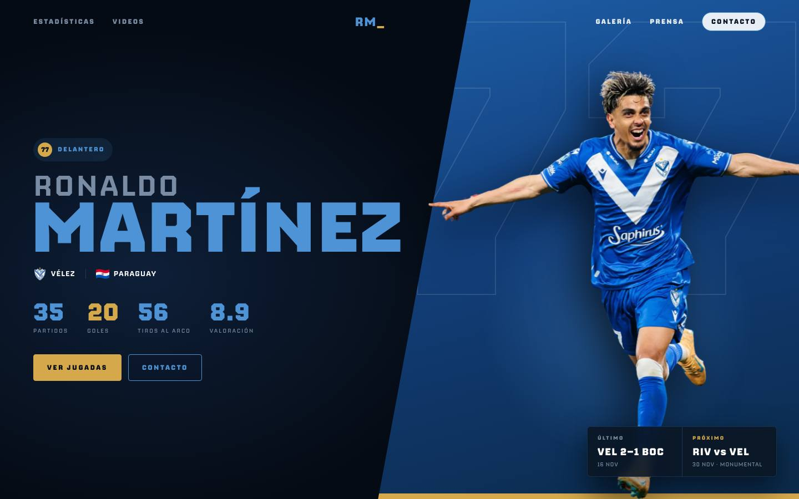 |

- **A5. Split con ficha (aplicado en Ronaldo Martínez):** el C6 en modo oscuro. A la izquierda, píldora con dorsal y posición, nombre en gris y apellido gigante en el acento, club y bandera, 4 números de la temporada (goles en dorado) y dos botones. A la derecha, panel en diagonal con degradé del club, el dorsal en contorno, un brillo detrás del recorte festejando y la tarjeta de partidos translúcida.
  - **React:** [`react/HeroSplitFichaAzul.jsx`](react/HeroSplitFichaAzul.jsx). Lee `name`, `fullName`, `number`, `position`, `currentClub`, `logoCurrentClub`, `nationality`, `nationalityFlag`, `heroCutout`, `heroCutoutAlt` y `seasonStats`; los partidos salen de `useMatches` (panel `/admin`).
  - **Temporada:** `useSeasonStats` (API-Football vía Firestore) con respaldo en `playerData.seasonStats`; los rótulos se buscan sin acentos con `seasonTiles()`. Copiá [`03-estadisticas/react/useSeasonStats.js`](../03-estadisticas/react/useSeasonStats.js) a `src/hooks/` y [`seasonTiles.js`](../03-estadisticas/react/seasonTiles.js) a `src/lib/`. Si el proyecto no tiene la sincronización, el hook puede devolver `null` y se usan los valores fijos.
  - Mobile: el recorte entero arriba dentro del panel y los datos abajo, sin taparse.
