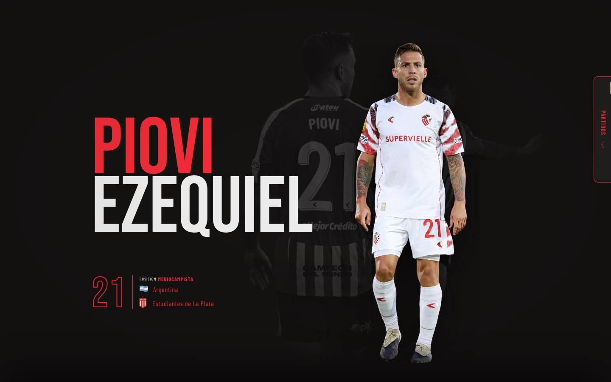

# Hero

## Modelo aplicado: Hero con recorte y scroll animado

**Archivos del starter:** `src/components/Hero/Hero.jsx` y `MatchBox.jsx`, `src/utils/heroUnits.js` y `src/hooks/useMatches.js`.

**Qué tiene**
- Apellido gigante en el acento y nombre en crema. Es el único `h1` de la página.
- Dorsal en contorno, posición, nacionalidad con bandera y club actual con escudo.
- Recorte PNG del jugador, de cuerpo entero, con `fetchpriority="high"` porque es la imagen principal de la página.
- Dos fotos de fondo. La segunda (`hero-bg2`) solo se ve en desktop, a la derecha.
- **MatchBox:** pestaña lateral "Partidos" con los próximos partidos. Los carga Firebase desde `/admin` y, si no está configurado, usa `matchData.js`.
- La sección mide `200svh` y su contenido queda fijo (`sticky`) mientras GSAP anima la salida con el scroll.

**Decisiones técnicas que conviene conservar**
- **Textos que no cambian con el zoom:** se usa la unidad `--hu`, basada en vw y calculada para 390, 820 y 1440 px de referencia, con la función `u(n)`. Así el hero se ve igual con el navegador al 80 % o al 125 %.
- **Alto estable en mobile:** `--sv` vale `1svh` (con `1vh` como respaldo). Antes se usaba `100dvh` y el hero cambiaba de tamaño al aparecer y desaparecer la barra del navegador.
  - `main.jsx` además configura `ScrollTrigger.config({ ignoreMobileResize: true })`.
  - La sección que se superpone después del hero usa `margin-top: -100svh`.
- **Celular horizontal:** `LANDSCAPE` cambia la referencia a `--sv` para que el hero entre en pantalla.

**Para adaptar**
- **Datos:** `name`, `fullName`, `number`, `position`, `nationality`, `nationalityFlag`, `currentClub`, `logoCurrentClub` e `image` en `playerData.js`.
- **Recorte:** cada recorte tiene otras proporciones. Hay que ajustar el `left`, el `h` y el `objectPosition` de la imagen del jugador y revisarlo en 390, 820 y 1440 px.
