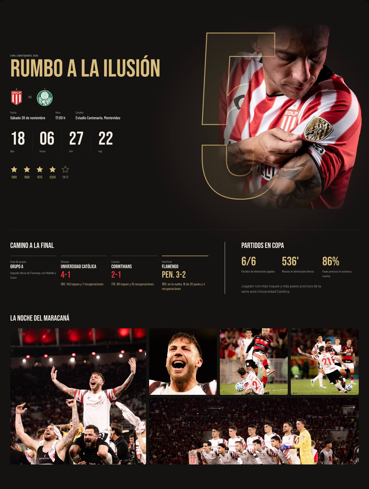

# Final (torneo destacado)

Sección para cuando el jugador está en una final o una copa importante. En Keki se llamó "Rumbo a la ilusión" y contó la llegada de Estudiantes a la final de la Libertadores 2026.

## Modelo aplicado: "La Quinta"

**Archivos del starter:** `src/components/Final/FinalSection.jsx` y `shared.jsx`, `src/data/finalData.js` y `src/hooks/useCountdown.js`.

**Qué tiene**
- **Número gigante en SVG:** es `titles.length + 1`, el título que se busca. Va detrás del recorte del jugador, que se funde con una máscara radial porque los recortes suelen terminar en seco.
- **Cabecera:** nombre de la copa, título (`copy.title`), escudos local contra rival, fecha, hora y estadio.
- **Cuenta regresiva** en días, horas, minutos y segundos. `useCountdown` devuelve un estado: `upcoming`, `today` o `past`.
- **Estrellas:** una llena por cada título ganado y una punteada para la final pendiente.
- **Camino a la final:** las rondas (`path`), cada una con su resultado y una línea sobre lo que hizo el jugador (`player`).
- **Números del jugador en la copa** (`playerStats`) y una nota (`playerNote`).
- **Galería de la noche clave** (`maracana`): en desktop es una grilla y en mobile un carrusel horizontal con snap.

**Para adaptar:** todo el contenido está en `finalData.js`: `competition`, `club`, `edition`, `copy`, `final`, `titles`, `history`, `path`, `playerStats`, `playerNote` y la galería. Si el jugador no tiene una final para destacar, sacá `<FinalSection />` de `App.jsx` y su link del navbar.

**Alternativas:** no quedaron guardadas. Las tres opciones originales se armaron antes de que existiera este repo y no se conservaron. Si hacen falta otras, hay que diseñarlas de nuevo con este modelo como base.
