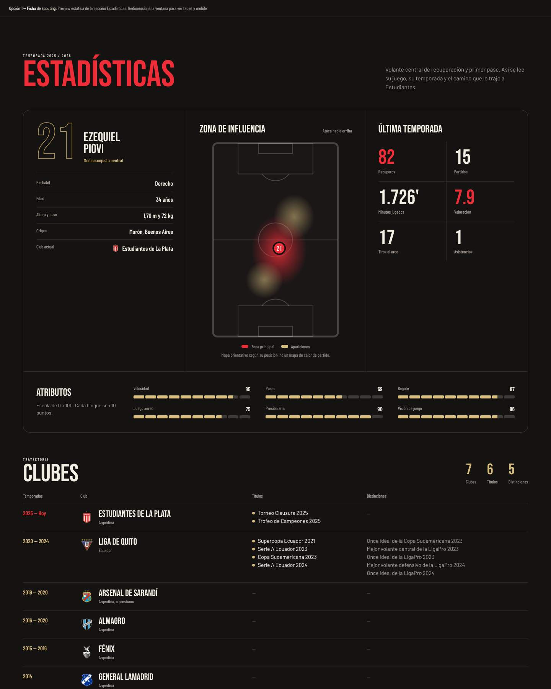
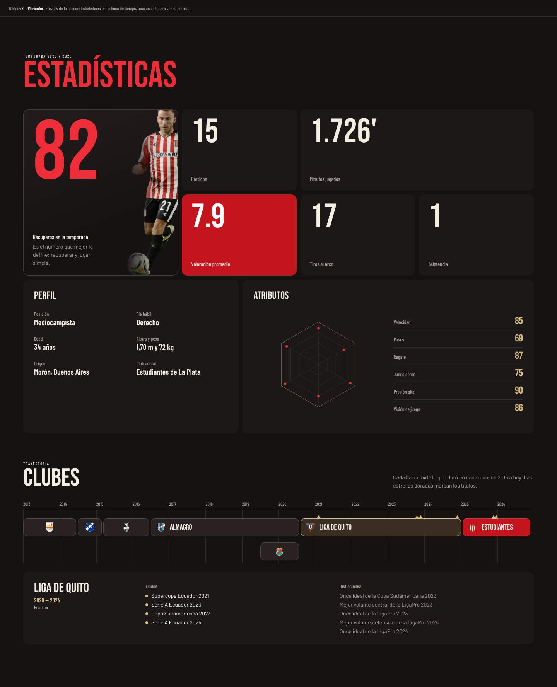
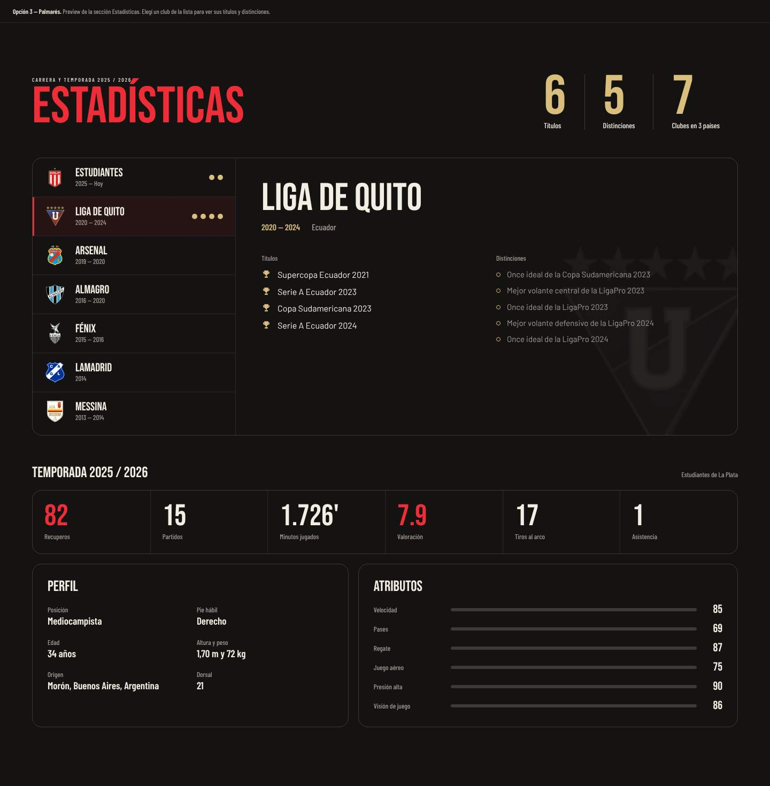
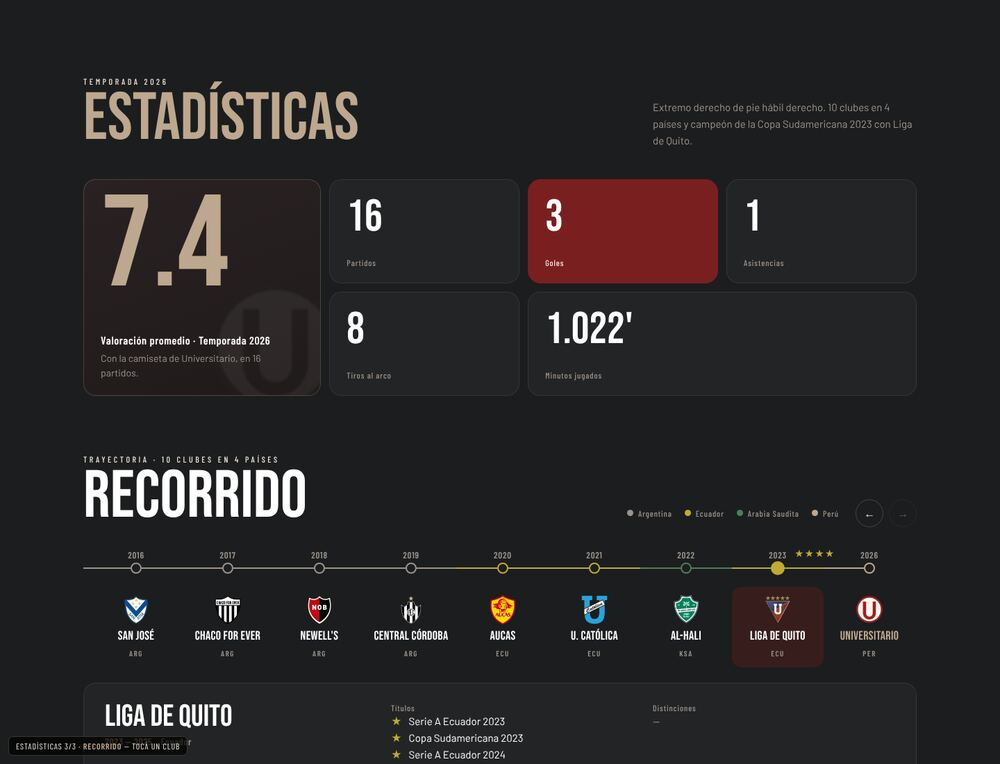

# Estadísticas

| # | Modelo | Estado | Preview |
|---|---|---|---|
| 1 | **Ficha de scouting** | ✅ Aplicado en Keki | [html](previews/opcion-1-ficha.html) ·  |
| 2 | Marcador | Alternativa | [html](previews/opcion-2-marcador.html) ·  |
| 3 | Palmarés | Alternativa | [html](previews/opcion-3-palmares.html) ·  |
| 4 | Recorrido | Alternativa (trayectoria aplicada en Lisandro Alzugaray) | [html](previews/opcion-4-recorrido.html) ·  |

## 1. Ficha de scouting (aplicado)

**Archivo:** `src/components/Stats/StatsSection.jsx`. Una tarjeta con tres paneles y debajo la trayectoria:

- **Perfil:** dorsal en contorno, nombre, posición detallada y una tabla con pie hábil, edad, altura y peso, origen y club actual.
- **Zona de influencia:** cancha en SVG con un "calor" en la zona del jugador. El `aria-label` sale de `pitchZoneLabel`.
- **Última temporada:** grilla de 6 números. Los que tienen `highlight` van en rojo.
- **Atributos:** barras segmentadas de 0 a 100, que son más legibles que un radar.
- **Clubes:** un renglón por club con años, escudo y país.
  - Cada renglón se abre si tiene `titles` o `info`. Usa `aria-expanded`.
  - El resumen de títulos y distinciones solo aparece si hay algo que mostrar. Se sacó el texto "Sin títulos ni distinciones".

Es el modelo para un jugador con datos de scouting y una carrera larga.

## 2. Marcador

Arriba, el número que mejor lo define en grande, junto a un recorte del jugador, al estilo de un tablero. Al lado, el resto de los números en bloques. Debajo, el perfil y los atributos en radar. Los clubes van en una línea de tiempo horizontal con estrellas en los años de títulos, y al tocar un club aparece su detalle.

Es el modelo con más impacto visual. Sirve para un jugador con una temporada muy fuerte en un número concreto (goles, recuperos, atajadas).

## 3. Palmarés

Arriba, contadores de títulos, distinciones y clubes en países. Debajo, la lista de clubes a la izquierda, con un punto por título, y el panel de detalle a la derecha. Más abajo, la fila de la temporada, el perfil y los atributos en barras.

Es el modelo para un jugador con muchos títulos o distinciones individuales.

## 4. Recorrido

Arriba, los números de la temporada en bloques, con el más representativo en grande y uno destacado en el color del club. Debajo, la carrera como una línea de tiempo horizontal: cada etapa es una parada con escudo, año de llegada y código de país, la línea toma el color de cada país y las estrellas doradas marcan los títulos. Al tocar un club aparece su detalle (años, país, títulos y distinciones). Las flechas mueven el riel con `scrollTo`.

Es el modelo para un jugador con muchos clubes y países. Un club puede aparecer más de una vez si volvió.

**En Lisandro Alzugaray** se combinó con la ficha del modelo 1: arriba la ficha (perfil, zona, temporada y atributos) y debajo el recorrido, ordenado del club actual al primero. En React: `src/components/Stats/ClubRoute.jsx`, con los datos `career` (etapas, de la más reciente a la primera) y `countries` (código y color) de `playerData.js`.
