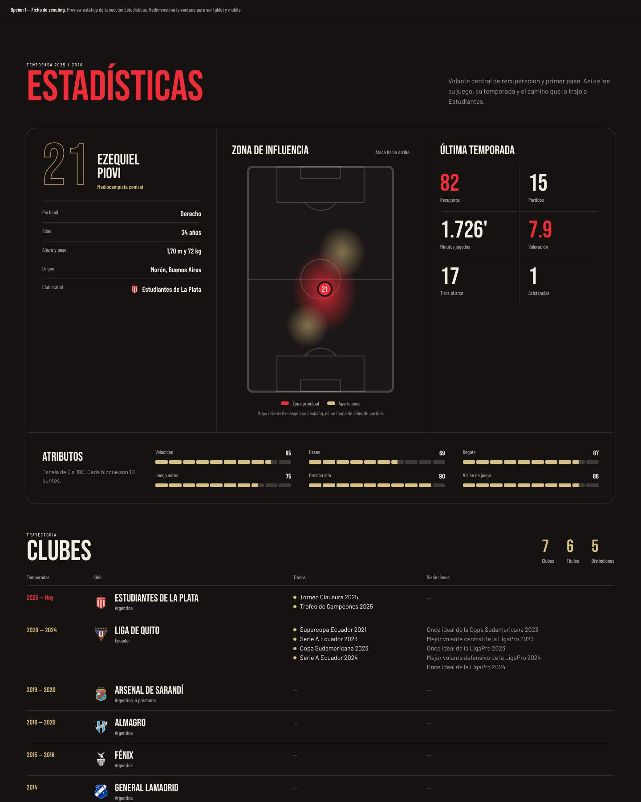
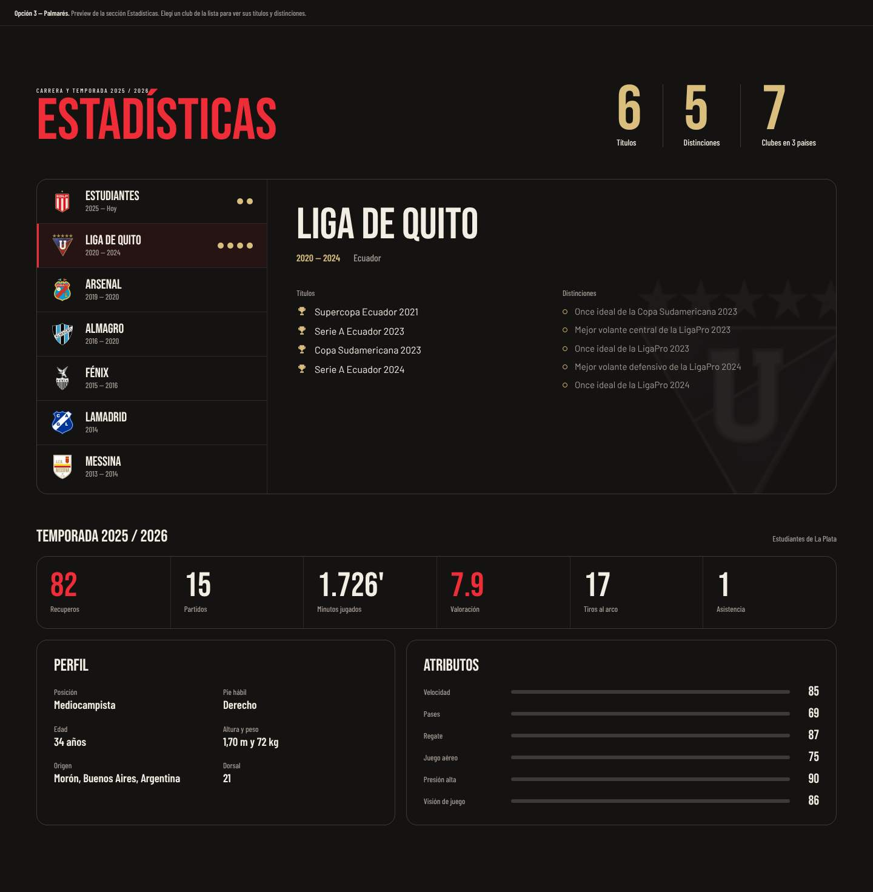
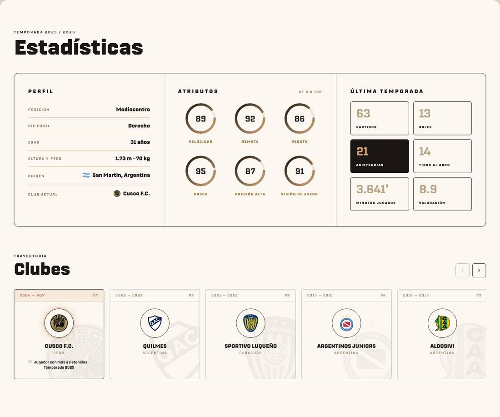
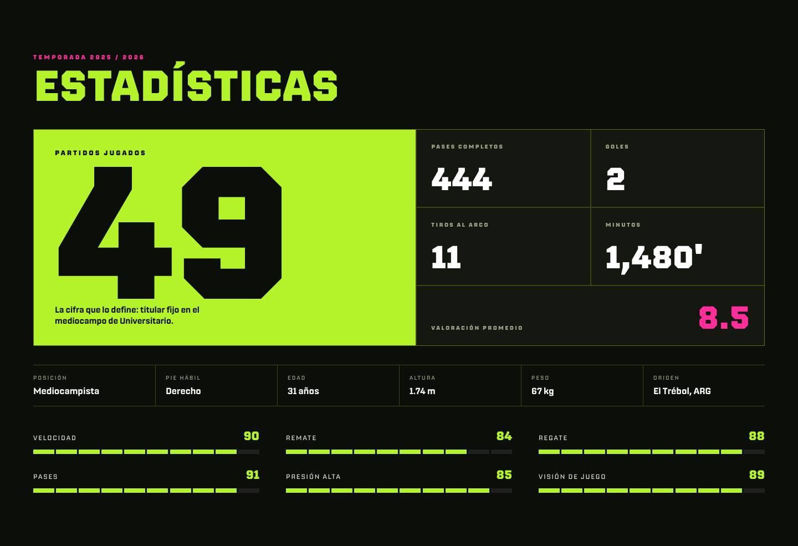
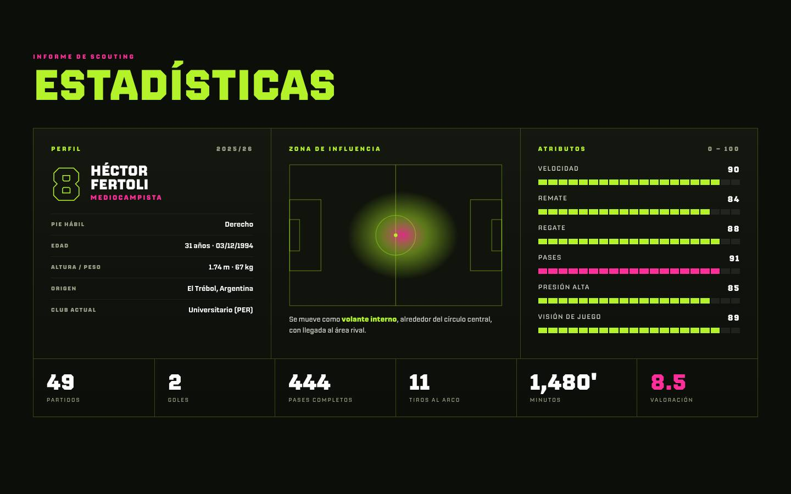
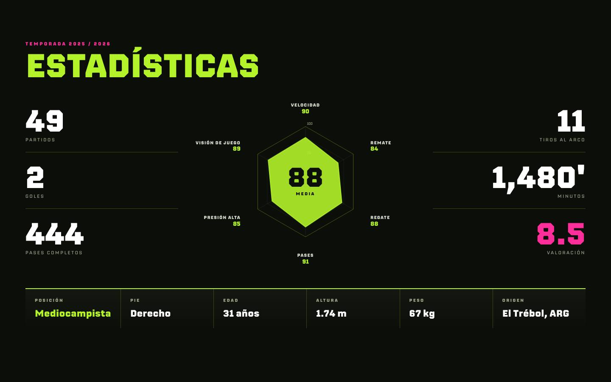
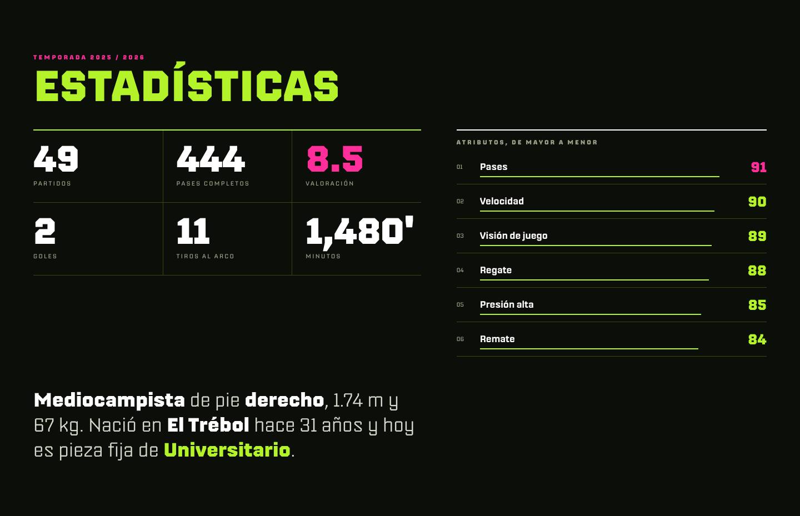

# Estadísticas

| # | Modelo | Estado | Preview |
|---|---|---|---|
| 1 | **Ficha de scouting** | ✅ Aplicado en Keki | [html](previews/opcion-1-ficha.html) ·  |
| 2 | Marcador | Alternativa | [html](previews/opcion-2-marcador.html) ·  |
| 3 | Palmarés | Alternativa | [html](previews/opcion-3-palmares.html) ·  |
| 4 | Anillos y tarjetas | Alternativa (clubes en tarjetas aplicado en Ivan Colman, junto al Marcador) | [html](previews/opcion-4-anillos-tarjetas.html) ·  |

## 1. Ficha de scouting (aplicado)

**Archivo:** `src/components/Stats/StatsSection.jsx`. Una tarjeta con tres paneles y debajo la trayectoria:

- **Perfil:** dorsal en contorno, nombre, posición detallada y una tabla con pie hábil, edad, altura y peso, origen y club actual.
- **Zona de influencia:** cancha en SVG con un "calor" en la zona del jugador. El `aria-label` sale de `pitchZoneLabel`.
- **Última temporada:** grilla de 6 números. Los que tienen `highlight` van en rojo.
- **Atributos:** barras segmentadas de 0 a 100, que son más legibles que un radar.
- **Clubes:** un renglón por club con años, escudo y país.
  - Cada renglón se abre si tiene `titles` o `info`. Usa `aria-expanded`.
  - El resumen de títulos y distinciones solo aparece si hay algo que mostrar. Se sacó el texto "Sin títulos ni distinciones".

Es el modelo para un jugador con datos de scouting y una carrera larga.

## 2. Marcador

Arriba, el número que mejor lo define en grande, junto a un recorte del jugador, al estilo de un tablero. Al lado, el resto de los números en bloques. Debajo, el perfil y los atributos en radar. Los clubes van en una línea de tiempo horizontal con estrellas en los años de títulos, y al tocar un club aparece su detalle.

Es el modelo con más impacto visual. Sirve para un jugador con una temporada muy fuerte en un número concreto (goles, recuperos, atajadas).

## 3. Palmarés

Arriba, contadores de títulos, distinciones y clubes en países. Debajo, la lista de clubes a la izquierda, con un punto por título, y el panel de detalle a la derecha. Más abajo, la fila de la temporada, el perfil y los atributos en barras.

Es el modelo para un jugador con muchos títulos o distinciones individuales.

## 4. Anillos y tarjetas

Tres columnas en un marco: perfil, atributos en anillos de progreso y la temporada en recuadros (el número clave en negro). Debajo, la trayectoria en tarjetas horizontales: banda con el período y el nº de etapa, escudo en círculo, escudo de marca de agua y títulos (punto lleno) o distinciones (punto en contorno). Las flechas usan `scrollTo` y se deshabilitan en los extremos.

Preview en paleta clara (crema, negro y dorado) con tipografía Nippo, la de Ivan Colman. En Ivan se combinó el **Marcador** (opción 2) con estas **tarjetas de clubes**: `ScoreboardStats.jsx` + `ClubsCards.jsx`.

Sirve para un jugador con carrera larga y pocos títulos, cuando se quiere una lectura rápida y visual de los atributos.

## Kit neón (diseñado para Héctor Fertoli)

Cuatro opciones más, en paleta oscura con acento lima y magenta y tipografía Nippo. Salen de [`kits/neon`](../../kits/neon/): los datos del jugador están en `player.js`, así que se pueden regenerar con otro jugador (ver el [README del kit](../../kits/neon/README.md)).

| # | Modelo | Estado | Preview |
|---|---|---|---|
| N1 | Marcador | Alternativa | [html](previews/neon-1-marcador.html) ·  |
| N2 | Ficha de scouting | Alternativa | [html](previews/neon-2-ficha.html) ·  |
| N3 | **Radar central** | ✅ Aplicado en Héctor Fertoli | [html](previews/neon-3-radar.html) ·  |
| N4 | Dossier | Alternativa | [html](previews/neon-4-dossier.html) ·  |

- **N1. Marcador:** el número que lo define (el primero de `season`) en un bloque gigante del acento, con una frase, y el resto en un tablero. Debajo, la ficha en una fila y los atributos en barras de 10 segmentos.
- **N2. Ficha de scouting:** informe en tres paneles: perfil con dorsal, cancha en SVG con la zona de influencia y atributos en barras finas (el mejor en magenta). Abajo, la temporada en 6 números. Es la versión neón de la opción 1.
- **N3. Radar central (aplicado en Fertoli):** los 6 atributos en un radar (escala de 50 a 100 para que se noten las diferencias) con la media en el centro, rodeado por los números de la temporada, mitad a cada lado. Al pie, la ficha en una franja de 6 columnas (2 en mobile).
  - **React:** [`react/RadarCenterStats.jsx`](react/RadarCenterStats.jsx). Se monta dentro de `StatsSection.jsx` con un selector (`STATS_DESIGN = 'radarCentral'`) y lee `stats`, `seasonStats`, `position`, `foot`, `age`, `height`, `weight` y `birthPlace`.
- **N4. Dossier:** estilo revista: la temporada en una grilla tipográfica, los atributos en un ranking de mayor a menor con una línea proporcional y una frase de presentación al pie.

Los clubes, que en Keki van dentro de esta sección, en el kit neón tienen sus propios modelos en [`09-clubes`](../09-clubes/).
