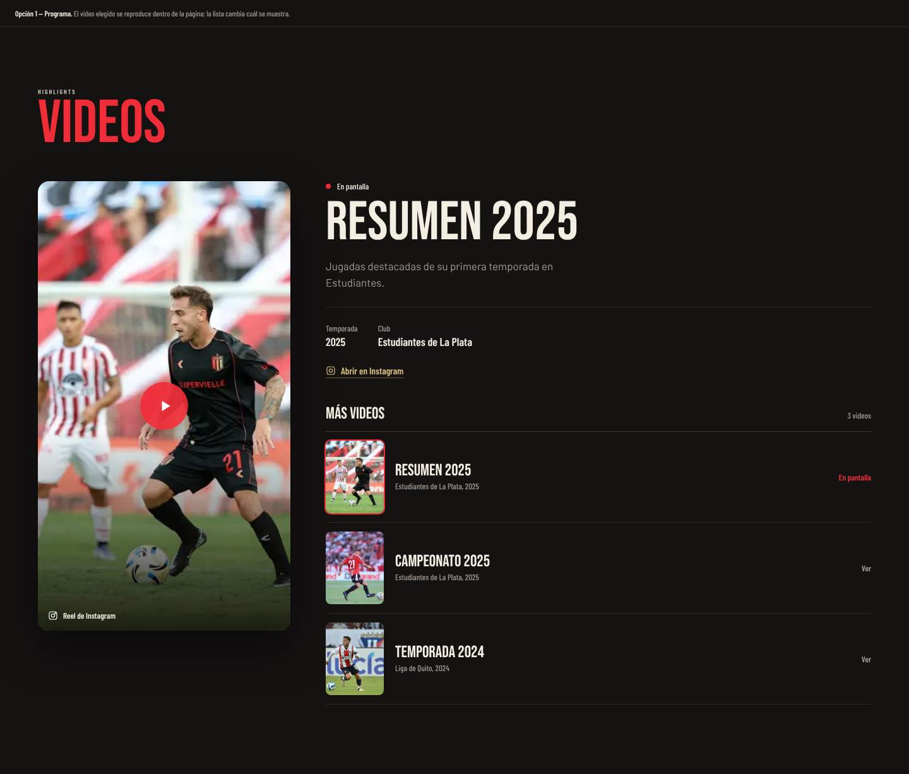
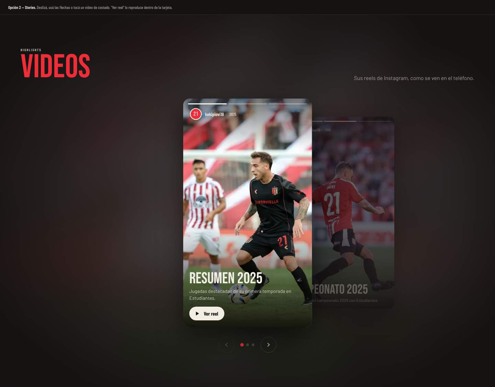
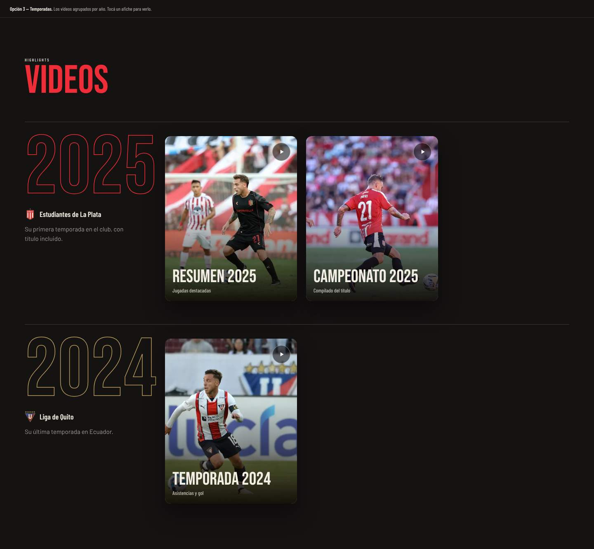
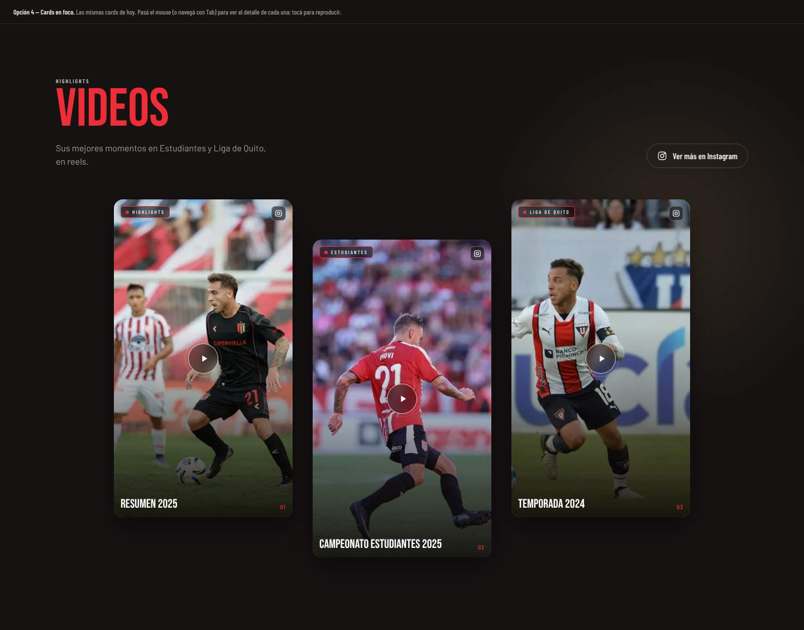
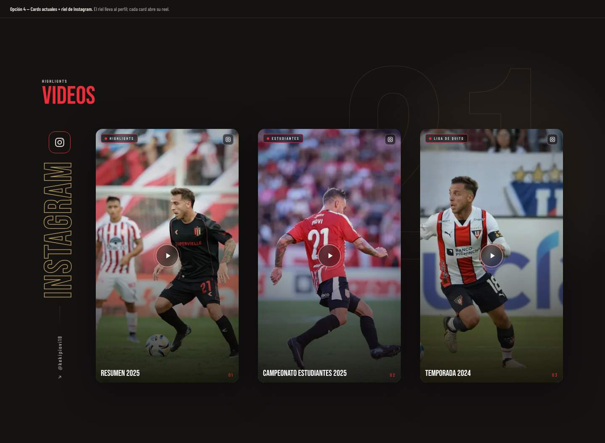

# Videos

| # | Modelo | Estado | Preview |
|---|---|---|---|
| 1 | Programa | Alternativa | [html](previews/opcion-1-programa.html) ·  |
| 2 | Stories | Alternativa | [html](previews/opcion-2-stories.html) ·  |
| 3 | Temporadas | Alternativa | [html](previews/opcion-3-temporadas.html) ·  |
| 4a | Cards en foco | Alternativa | [html](previews/opcion-4-cards.html) ·  |
| 4b | **Cards + riel de Instagram** | ✅ Aplicado en Keki | [html](previews/opcion-4-riel.html) ·  |

## 4b. Cards + riel de Instagram (aplicado)

**Archivos:** `src/components/Videos/VideosSection.jsx`, `VideoCard.jsx` e `InstagramRail.jsx`.

- **Slider:** las cards son reels verticales con portada y se reproducen dentro de la card. Hay flechas para avanzar.
- **Riel a la izquierda:** una columna del mismo alto que las cards, con el logo de Instagram y la palabra "Instagram" en vertical.
  - `useFitWord` ajusta la palabra al alto disponible. En mobile el espaciado entre letras tiene un tope (`MOBILE_MAX_SPACING`), y el usuario (`@...`, en dorado) completa el alto que sobra.
  - En mobile el riel muestra siempre los colores del hover, porque ahí no existe el hover.
  - Ancho del riel: 48 px en mobile, 64 px en tablet y 84 px en desktop.
- **Detalles técnicos:**
  - Las flechas usan `slider.scrollTo()`. Con `scrollIntoView()` se corría toda la sección hacia los costados.
  - La sección tiene `overflow: clip` (con `@supports`) para que nada se desborde.

## Alternativas

- **1. Programa:** un video principal grande que se reproduce en la página y, al lado, una lista "Más videos" para cambiarlo. Es el modelo para pocos videos largos (resúmenes de temporada).
- **2. Stories:** las cards se apilan como historias de Instagram, con flechas y puntos. Cada una tiene un botón "Ver reel". Es el más compacto.
- **3. Temporadas:** los videos se agrupan por año, con el año gigante en contorno y el club debajo. Es el modelo para una carrera con videos en varios clubes.
- **4a. Cards en foco:** las mismas cards que el aplicado, pero en alturas escalonadas. Al pasar el mouse o llegar con Tab, la card se agranda y muestra su detalle.
