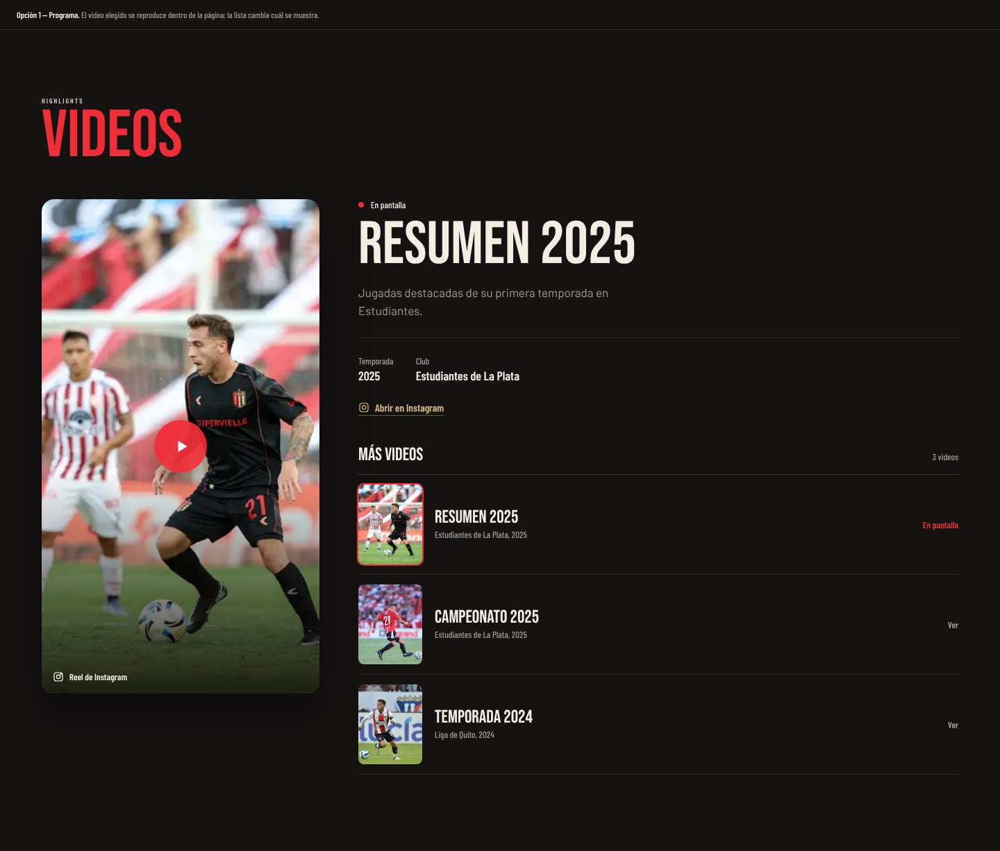
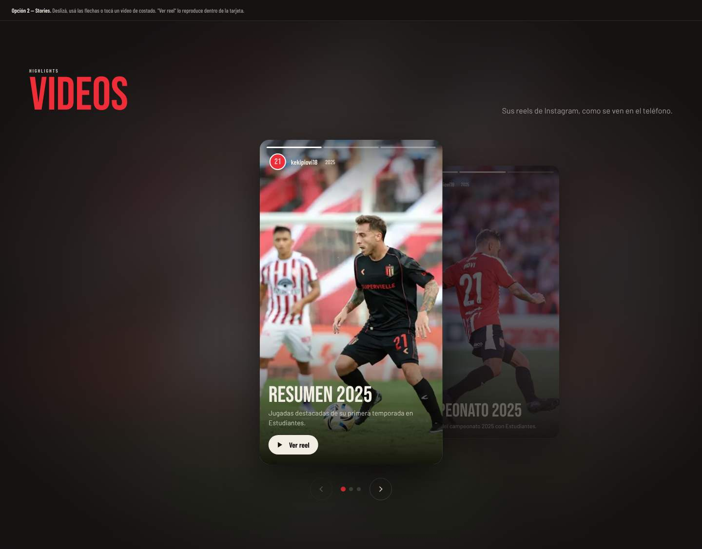
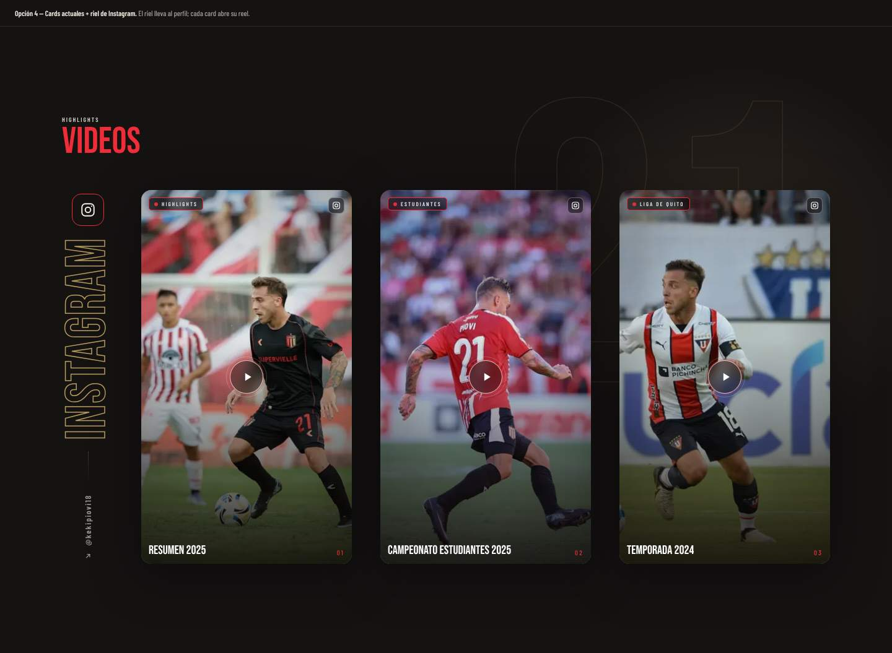
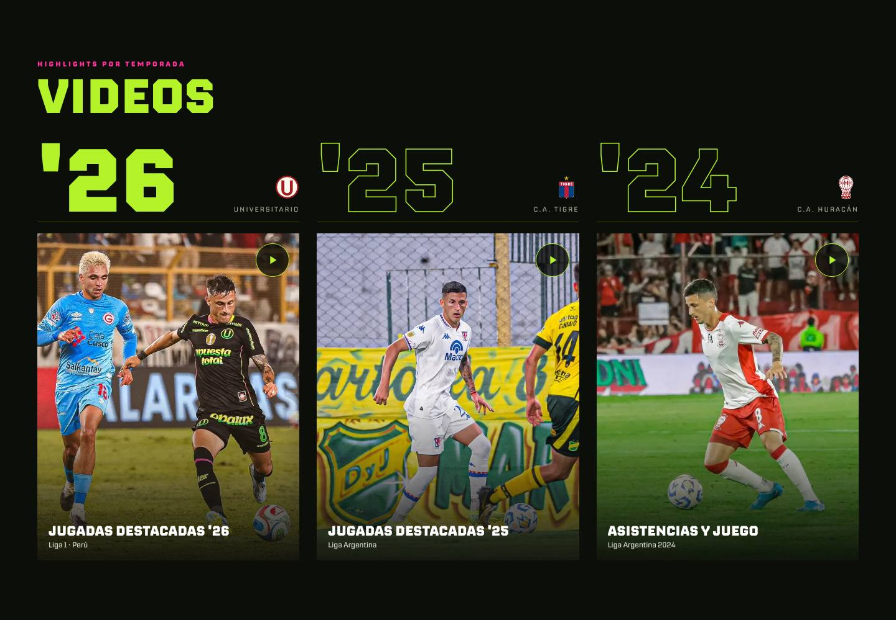
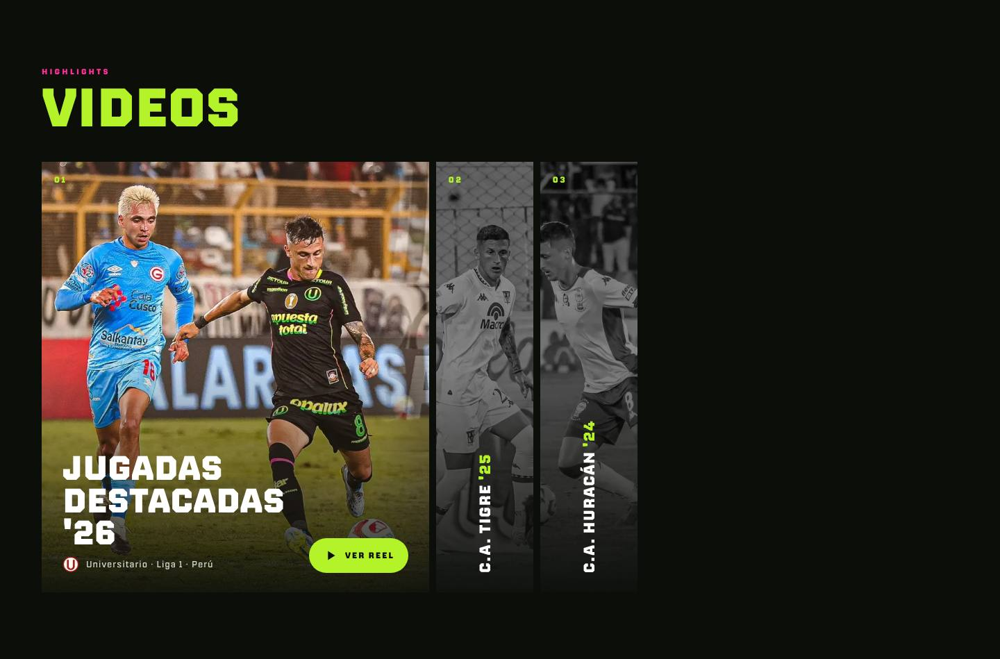

# Videos

| # | Modelo | Estado | Preview |
|---|---|---|---|
| 1 | Programa | Alternativa (aplicado en Ivan Colman) | [html](previews/opcion-1-programa.html) ·  |
| 2 | Stories | Alternativa | [html](previews/opcion-2-stories.html) ·  |
| 3 | Temporadas | Alternativa | [html](previews/opcion-3-temporadas.html) ·  |
| 4a | Cards en foco | Alternativa | [html](previews/opcion-4-cards.html) ·  |
| 4b | **Cards + riel de Instagram** | ✅ Aplicado en Keki | [html](previews/opcion-4-riel.html) ·  |

## 4b. Cards + riel de Instagram (aplicado)

**Archivos:** `src/components/Videos/VideosSection.jsx`, `VideoCard.jsx` e `InstagramRail.jsx`.

- **Slider:** las cards son reels verticales con portada y se reproducen dentro de la card. Hay flechas para avanzar.
- **Riel a la izquierda:** una columna del mismo alto que las cards, con el logo de Instagram y la palabra "Instagram" en vertical.
  - `useFitWord` ajusta la palabra al alto disponible. En mobile el espaciado entre letras tiene un tope (`MOBILE_MAX_SPACING`), y el usuario (`@...`, en dorado) completa el alto que sobra.
  - En mobile el riel muestra siempre los colores del hover, porque ahí no existe el hover.
  - Ancho del riel: 48 px en mobile, 64 px en tablet y 84 px en desktop.
- **Detalles técnicos:**
  - Las flechas usan `slider.scrollTo()`. Con `scrollIntoView()` se corría toda la sección hacia los costados.
  - La sección tiene `overflow: clip` (con `@supports`) para que nada se desborde.

## Alternativas

- **1. Programa:** un video principal grande que se reproduce en la página y, al lado, una lista "Más videos" para cambiarlo. Es el modelo para pocos videos largos (resúmenes de temporada).
  - Implementado en Ivan Colman (`VideosSection.jsx`, `VideoCard.jsx`, `videos.css`): todo el bloque entra en el alto visible. El alto de la pantalla sale de `svh` menos la navbar fija, el padding y el título; la ficha toma ese mismo alto y la lista scrollea por dentro solo si hay muchos videos.
  - Las variables con `clamp()` van en un `.css` aparte: en `sx` de Chakra algunas se descartaban.
- **2. Stories:** las cards se apilan como historias de Instagram, con flechas y puntos. Cada una tiene un botón "Ver reel". Es el más compacto.
- **3. Temporadas:** los videos se agrupan por año, con el año gigante en contorno y el club debajo. Es el modelo para una carrera con videos en varios clubes.
- **4a. Cards en foco:** las mismas cards que el aplicado, pero en alturas escalonadas. Al pasar el mouse o llegar con Tab, la card se agranda y muestra su detalle.

## Kit neón (diseñado para Héctor Fertoli)

Cuatro opciones más, en paleta oscura con acento lima y magenta y tipografía Nippo. Salen de [`kits/neon`](../../kits/neon/): los datos del jugador están en `player.js`, así que se pueden regenerar con otro jugador (ver el [README del kit](../../kits/neon/README.md)).

| # | Modelo | Estado | Preview |
|---|---|---|---|
| N1 | Programa | Alternativa | [html](previews/neon-1-programa.html) ·  |
| N2 | Stories | Alternativa | [html](previews/neon-2-stories.html) ·  |
| N3 | **Temporadas** | ✅ Aplicado en Héctor Fertoli | [html](previews/neon-3-temporadas.html) ·  |
| N4 | Paneles | Alternativa | [html](previews/neon-4-paneles.html) ·  |

- **N1. Programa:** un reel grande y, al lado, título, club y la lista "Más videos" para cambiarlo. Versión neón de la opción 1.
- **N2. Stories:** los reels como historias de Instagram, con barras de progreso, usuario, botón "Ver reel" y círculos por club. Avanzan solos cada 6 segundos (se frenan con reducir movimiento).
- **N3. Temporadas (aplicado en Fertoli):** cada video bajo su año gigante en contorno (`'26`, `'25`…) con el escudo del club. El reel se abre en un modal de Instagram.
  - **React:** [`react/VideosTemporadas.jsx`](react/VideosTemporadas.jsx) (en el proyecto se llama `VideosSection.jsx`) y [`react/VideoCardNeon.jsx`](react/VideoCardNeon.jsx). Cada video necesita `year`, `club`, `clubLogo`, `league` y `cover` (o `thumbnail`), además del código del reel.
- **N4. Paneles:** paneles a todo el ancho; el activo se abre grande y a color y los otros quedan finos, en blanco y negro, con el club en vertical. Hover en desktop, toque en mobile (acordeón vertical).
