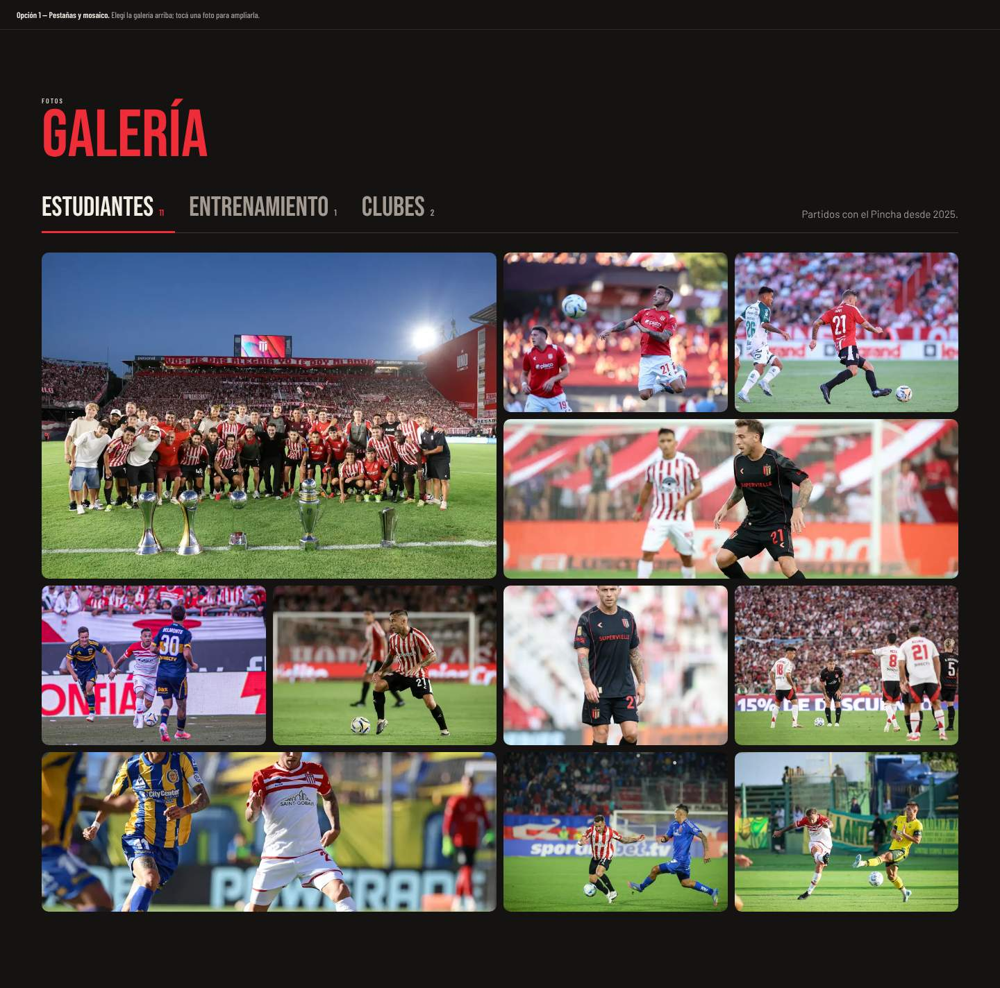
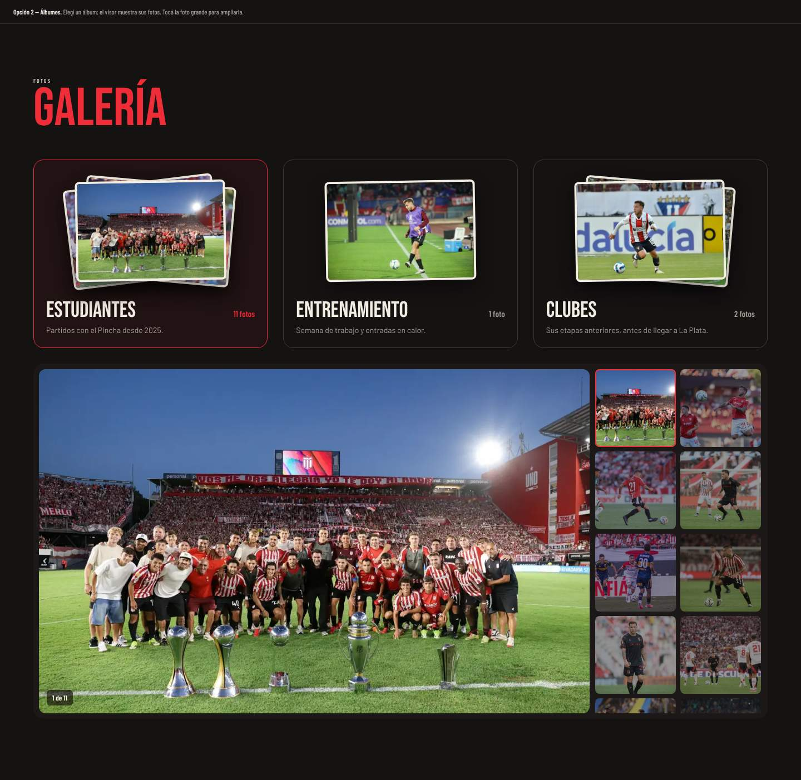
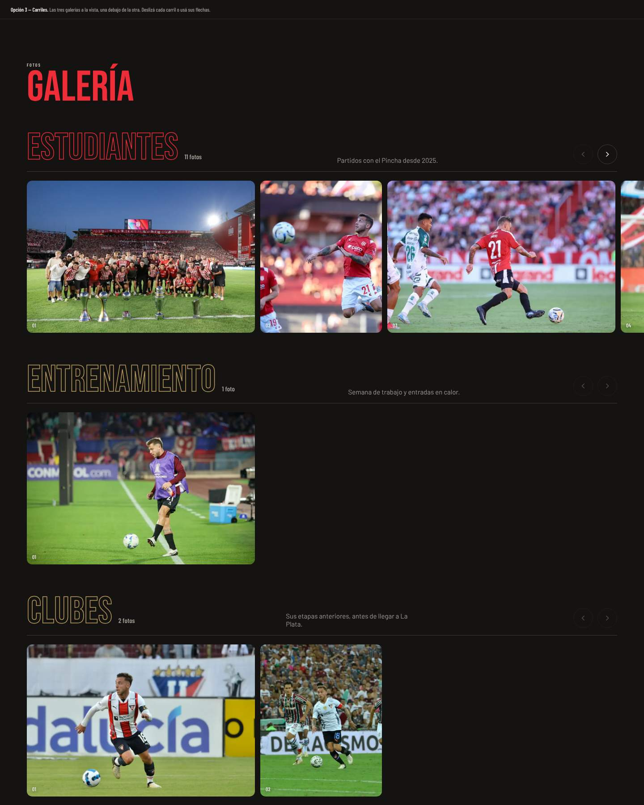

# Galería

| # | Modelo | Estado | Preview |
|---|---|---|---|
| 1 | **Pestañas y mosaico** | ✅ Aplicado en Keki | [html](previews/opcion-1-pestanas.html) ·  |
| 2 | Álbumes | Alternativa | [html](previews/opcion-2-albumes.html) ·  |
| 3 | Carriles | Alternativa | [html](previews/opcion-3-carriles.html) ·  |

Las fotos se dividen por categoría (en Keki: Estudiantes, Entrenamiento y Clubes) en `playerData.galleries`.

## 1. Pestañas y mosaico (aplicado)

**Archivo:** `src/components/Gallery/GallerySection.jsx`.

- **Pestañas:** una por categoría, marcadas con una línea debajo, accesibles con teclado (`role="tab"`).
- **Mosaico de 4 columnas en desktop y 2 en mobile:**
  - Con 5 fotos o más, la primera ocupa 2×2.
  - Cada 5 fotos hay una ancha (posiciones 3, 8, 13…).
- **"Ver más":** se ven las primeras 4 fotos (`VISIBLE = 4`). El resto queda colapsado detrás de "Ver más fotos +N" y se cierra con "Ver menos".
- **Grilla sin huecos:** `shapesFor()` ensancha las últimas celdas para que el total sea múltiplo de 4, así cada grilla cierra pareja en las dos columnas de mobile y en las cuatro de desktop. Con 5 fotos o más hay dos grillas, las primeras 4 y el resto, y se ajusta solo la segunda.
- **Encuadre por foto:** el campo `pos` es el `objectPosition`. Por ejemplo, `'center 20%'` para un retrato vertical que en una celda ancha cortaría la cara.
- **Visor:** un lightbox con flechas, sobre un Modal de Chakra.

**Al cargar fotos:**
- Convertir a WebP con un máximo de 1800 px y calidad 80.
- Poner primero las mejores, porque las 4 iniciales son las que se ven sin tocar nada.
- Revisar en una captura que ninguna cara quede cortada.

## Alternativas

- **2. Álbumes:** arriba, una portada por categoría con fotos apiladas y la cantidad. Debajo, un visor con la foto grande y la grilla de miniaturas al costado. Es el modelo para muchas fotos por categoría.
- **3. Carriles:** una fila horizontal por categoría, con el título en contorno y flechas. Se ven todas las categorías a la vez sin pestañas. Funciona bien con pocas fotos por categoría.
