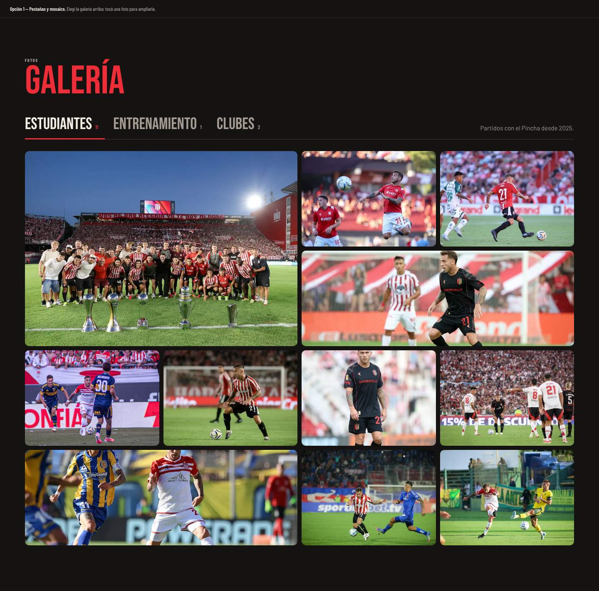
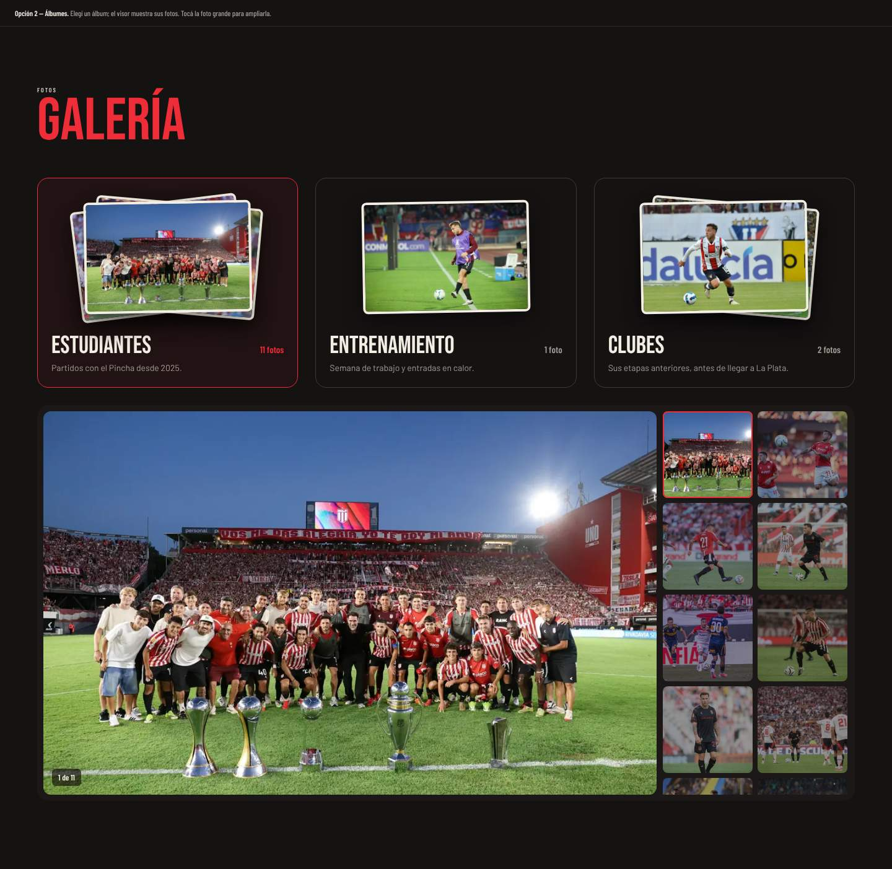
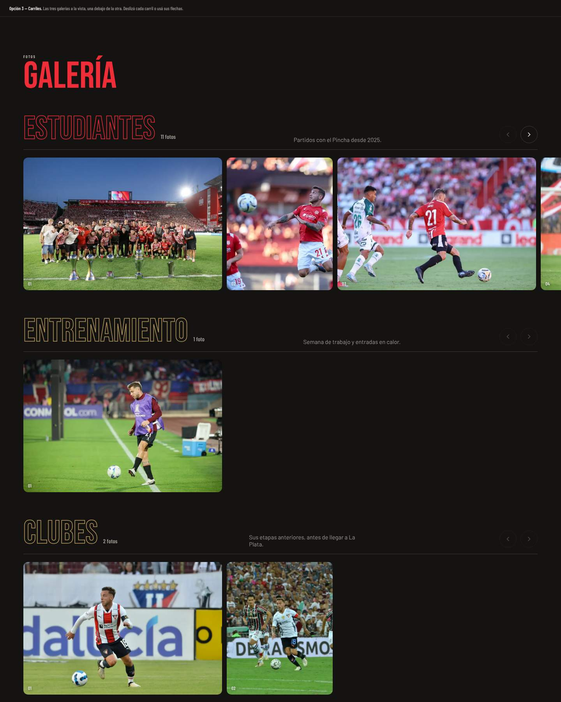
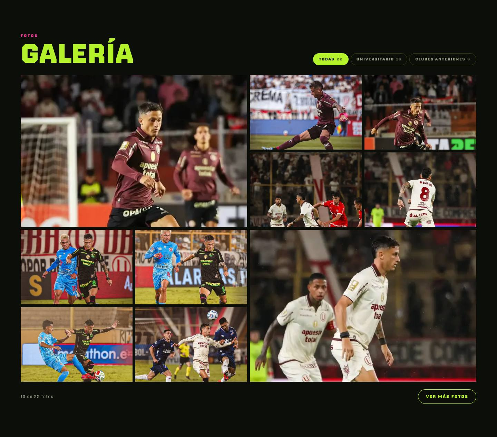
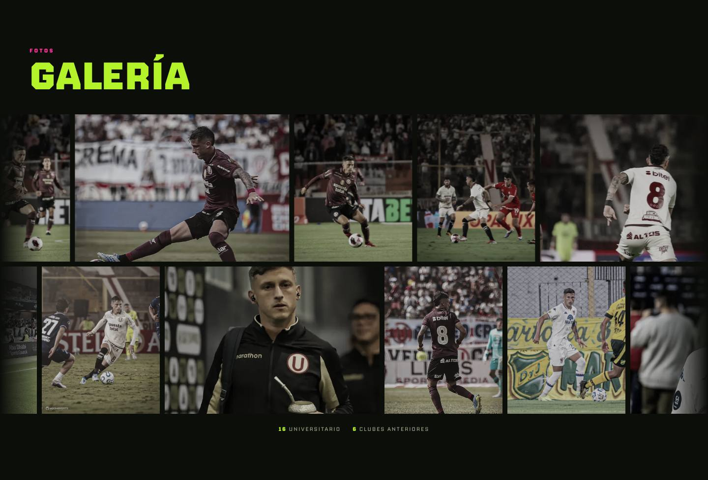
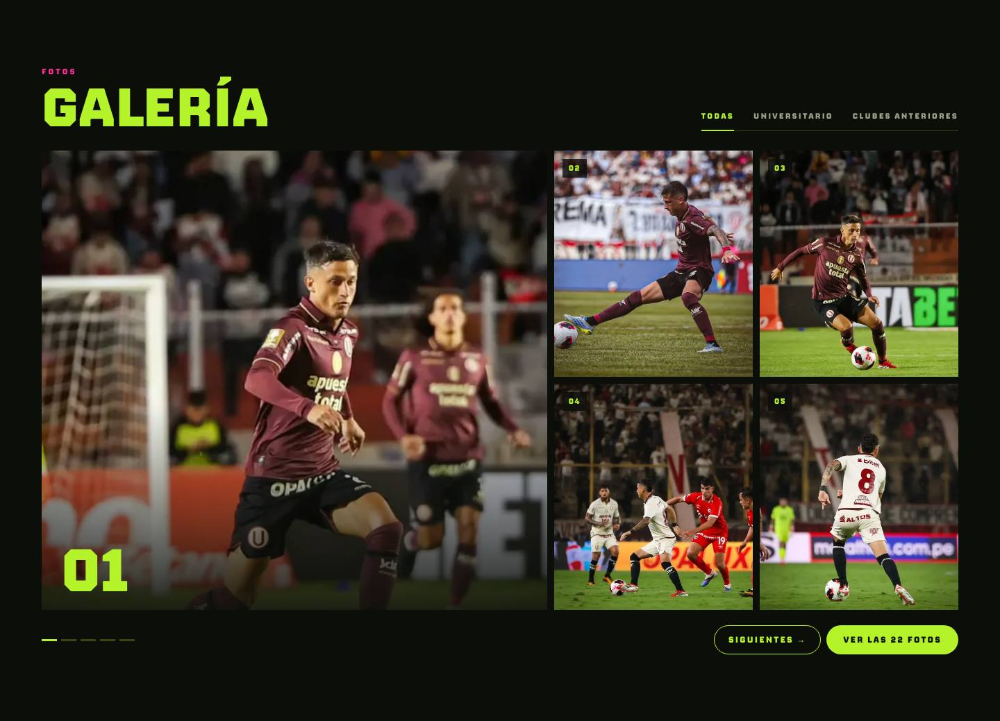
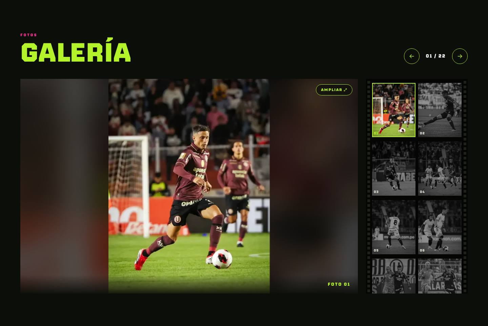
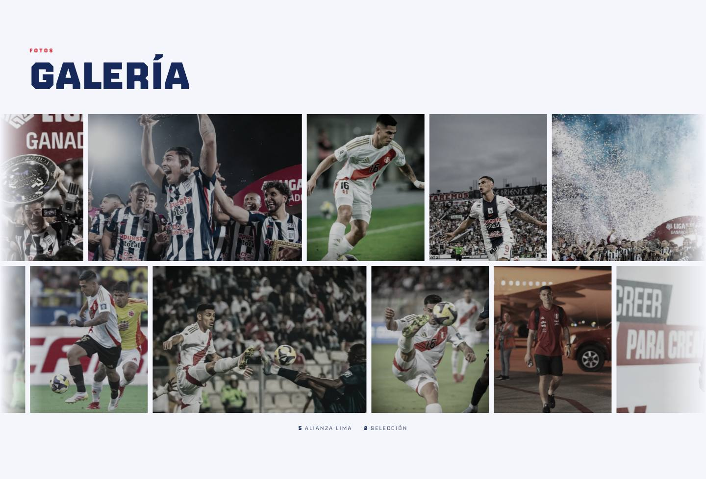
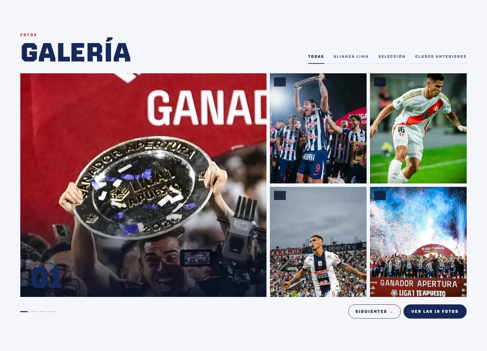
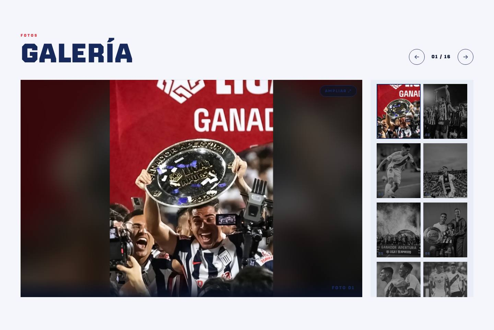

# Galería

| # | Modelo | Estado | Preview |
|---|---|---|---|
| 1 | **Pestañas y mosaico** | ✅ Aplicado en Keki | [html](previews/opcion-1-pestanas.html) ·  |
| 2 | Álbumes | Alternativa | [html](previews/opcion-2-albumes.html) ·  |
| 3 | Carriles | Alternativa (aplicado en Ivan Colman) | [html](previews/opcion-3-carriles.html) ·  |

Las fotos se dividen por categoría (en Keki: Estudiantes, Entrenamiento y Clubes) en `playerData.galleries`.

## 1. Pestañas y mosaico (aplicado)

**Archivo:** `src/components/Gallery/GallerySection.jsx`.

- **Pestañas:** una por categoría, marcadas con una línea debajo, accesibles con teclado (`role="tab"`).
- **Mosaico de 4 columnas en desktop y 2 en mobile:**
  - Con 5 fotos o más, la primera ocupa 2×2.
  - Cada 5 fotos hay una ancha (posiciones 3, 8, 13…).
- **"Ver más":** se ven las primeras 4 fotos (`VISIBLE = 4`). El resto queda colapsado detrás de "Ver más fotos +N" y se cierra con "Ver menos".
- **Grilla sin huecos:** `shapesFor()` ensancha las últimas celdas para que el total sea múltiplo de 4, así cada grilla cierra pareja en las dos columnas de mobile y en las cuatro de desktop. Con 5 fotos o más hay dos grillas, las primeras 4 y el resto, y se ajusta solo la segunda.
- **Encuadre por foto:** el campo `pos` es el `objectPosition`. Por ejemplo, `'center 20%'` para un retrato vertical que en una celda ancha cortaría la cara.
- **Visor:** un lightbox con flechas, sobre un Modal de Chakra.

**Al cargar fotos:**
- Convertir a WebP con un máximo de 1800 px y calidad 80.
- Poner primero las mejores, porque las 4 iniciales son las que se ven sin tocar nada.
- Revisar en una captura que ninguna cara quede cortada.

## Alternativas

- **2. Álbumes:** arriba, una portada por categoría con fotos apiladas y la cantidad. Debajo, un visor con la foto grande y la grilla de miniaturas al costado. Es el modelo para muchas fotos por categoría.
- **3. Carriles:** una fila horizontal por categoría, con el título en contorno y flechas. Se ven todas las categorías a la vez sin pestañas. Funciona bien con pocas fotos por categoría.
  - Implementado en Ivan Colman (`GallerySection.jsx`). Cada foto lleva `shape` (`tall` | `square` | `wide`) en `playerData.galleries`: el ancho de la celda sale de esa forma y del alto del carril (240/280/340 px), así no hay saltos al cargar. En celular se ocultan las flechas y el carril se desliza.
  - Contorno de los títulos: usar `WebkitTextStrokeWidth` y `WebkitTextStrokeColor` por separado. El atajo `WebkitTextStroke` responsive pisa el color y el texto desaparece.

## Kit neón (diseñado para Héctor Fertoli)

Cuatro opciones más, en paleta oscura con acento lima y magenta y tipografía Nippo. Salen de [`kits/neon`](../../kits/neon/): los datos del jugador están en `player.js`, así que se pueden regenerar con otro jugador (ver el [README del kit](../../kits/neon/README.md)).

| # | Modelo | Estado | Preview |
|---|---|---|---|
| N1 | **Mosaico con pestañas** | ✅ Aplicado en Héctor Fertoli | [html](previews/neon-1-mosaico.html) ·  |
| N2 | Carriles | Alternativa | [html](previews/neon-2-carriles.html) ·  |
| N3 | Álbum editorial | Alternativa | [html](previews/neon-3-album.html) ·  |
| N4 | Hoja de contactos | Alternativa | [html](previews/neon-4-hoja.html) ·  |

- **N1. Mosaico con pestañas (aplicado en Fertoli):** grilla de 4 columnas con una foto grande (2×2) cada cinco, pestañas Todas / club actual / Clubes anteriores, "Ver más fotos" que cierra sin huecos y visor a pantalla completa. Muestra 10 en desktop y 5 en mobile.
  - **React:** [`react/GalleryMosaicoNeon.jsx`](react/GalleryMosaicoNeon.jsx). Usa `playerData.gallery` (una sola lista) con `{ src, cat: 'u' | 'c', alt }`; la pestaña del club actual toma el nombre de `currentClub`.
- **N2. Carriles:** dos filas de fotos que corren solas en sentidos opuestos. Se frenan con el mouse y cualquier foto se abre grande. Versión neón de la opción 3.
- **N3. Álbum editorial:** una foto destacada con su número y cuatro al costado; "Siguientes" pasa de a cinco y "Ver las N fotos" abre el visor.
- **N4. Hoja de contactos:** visor grande con la foto completa (sin recortes, con la misma foto desenfocada de fondo) y una tira de película numerada en blanco y negro; la elegida se enciende a color. Sirve cuando hay fotos verticales y horizontales mezcladas.

Las descripciones de las fotos van solo como texto alternativo: el usuario pidió que no se vean en pantalla.

## Kit claro (diseñado para Luis Ramos)

Opciones en paleta clara (blanco azulado, azul del club y rojo) con tipografía Nippo, desde [`kits/claro`](../../kits/claro/). Los datos salen de `kits/claro/player.js`.

| # | Modelo | Estado | Preview |
|---|---|---|---|
| C1 | Mosaico con pestañas | Alternativa | [html](previews/claro-1-mosaico.html) ·  |
| C2 | **Carriles** | ✅ Aplicado en Luis Ramos | [html](previews/claro-2-carriles.html) ·  |
| C3 | Álbum editorial | Alternativa | [html](previews/claro-3-album.html) ·  |
| C4 | Hoja de contactos | Alternativa | [html](previews/claro-4-hoja.html) ·  |

- **C1. Mosaico con pestañas:** Grilla con una foto grande cada cinco, filtros por Alianza, Selección y clubes anteriores, "Ver más fotos" sin huecos y visor a pantalla completa.
- **C2. Carriles (aplicado en Luis Ramos):** Dos filas de fotos que corren solas en sentidos opuestos. Se frenan con el mouse y cualquier foto se abre grande.
  - **React:** [`react/GalleryCarriles.jsx`](react/GalleryCarriles.jsx).
- **C3. Álbum editorial:** Una foto destacada y cuatro al costado; "Siguientes" pasa de a cinco y "Ver todas" abre el visor.
- **C4. Hoja de contactos:** Visor grande con la foto completa y una tira numerada en blanco y negro para elegir.

En React, cada foto lleva `group` ('u' club actual, 's' selección, 'c' clubes anteriores) para el contador del pie.
