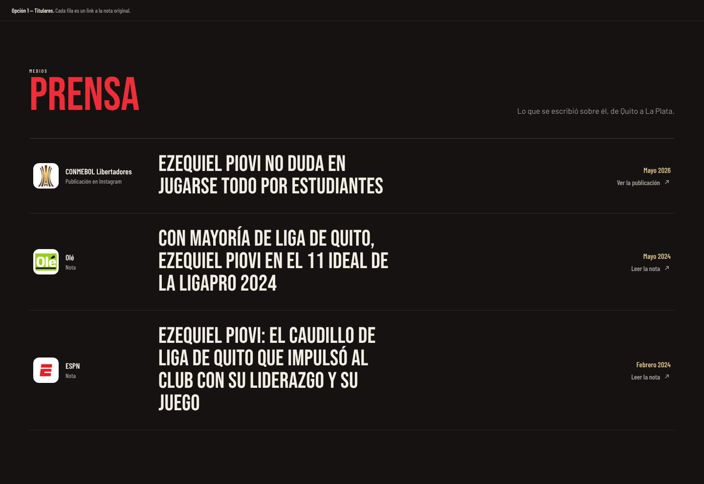
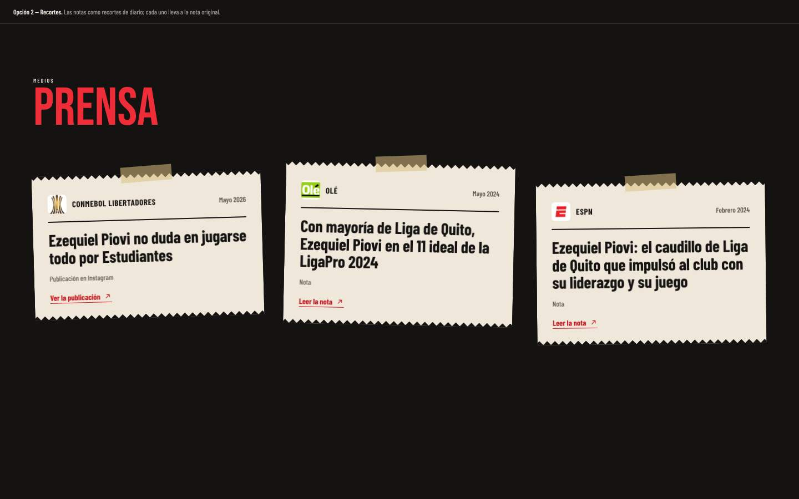
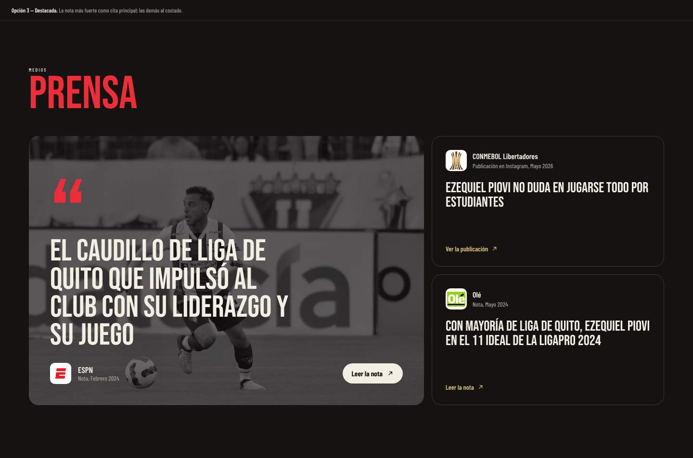
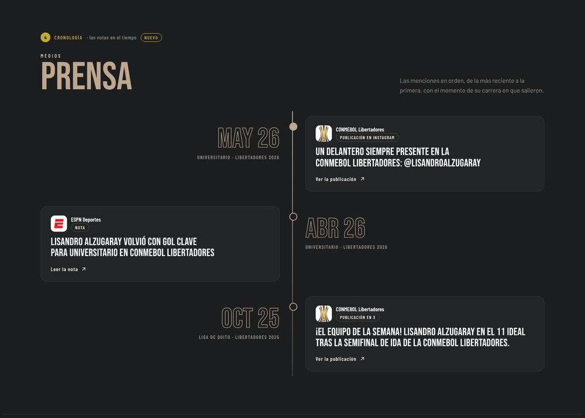

# Prensa

| # | Modelo | Estado | Preview |
|---|---|---|---|
| 1 | **Titulares** | ✅ Aplicado en Keki | [html](previews/opcion-1-titulares.html) ·  |
| 2 | Recortes | Alternativa | [html](previews/opcion-2-recortes.html) ·  |
| 3 | Destacada | Alternativa | [html](previews/opcion-3-destacada.html) ·  |
| 4 | Cronología | Alternativa | [html](previews/opcion-4-cronologia.html) ·  |
| 5 | Citas | Alternativa (aplicada en Lisandro Alzugaray) | [html](previews/opcion-5-citas.html) ·  |

Los datos están en `playerData.press`: `{ media, logo, type, title, date, url }`. Conviene sacar los emojis de los titulares: en Windows las banderas se ven como letras.

## 1. Titulares (aplicado)

**Archivo:** `src/components/Press/PressSection.jsx`. Un renglón por nota, que es un link entero, con el logo del medio, el tipo (Nota o Publicación), la fecha, el titular grande y una flecha. Al pasar el mouse el renglón se resalta. Es sobrio y se adapta a cualquier cantidad de notas.

## Alternativas

- **2. Recortes:** cada nota es un recorte de diario sobre papel crema, con cinta y borde dentado, levemente girado. Tiene mucha personalidad y funciona hasta con 3 o 4 notas.
- **3. Destacada:** la nota más fuerte va grande, con una foto en blanco y negro y la cita entre comillas. Las demás van en una columna al costado. Es el modelo para cuando hay una nota claramente mejor que el resto.
- **4. Cronología:** las notas sobre una línea de tiempo vertical, con la fecha grande en contorno y el momento de la carrera en que salieron (club y torneo). En desktop alternan de lado; en mobile van todas a la derecha de la línea. Sirve para mostrar que la prensa lo acompañó a lo largo de una temporada o de varios clubes.
- **5. Citas:** un titular a la vez en tipografía enorme, como cita, con comillas en el color del club. Debajo, los medios como pestañas (`role="tab"`, flechas del teclado) para cambiar de nota. Funciona bien con 3 a 5 notas de titulares cortos.

**Citas en React (Lisandro Alzugaray):** `src/components/Press/PressSection.jsx`. Usa `type` y `cta` de cada nota (`cta` es el texto del botón: "Leer la nota" o "Ver la publicación") y `pressIntro` para el texto de apertura.
