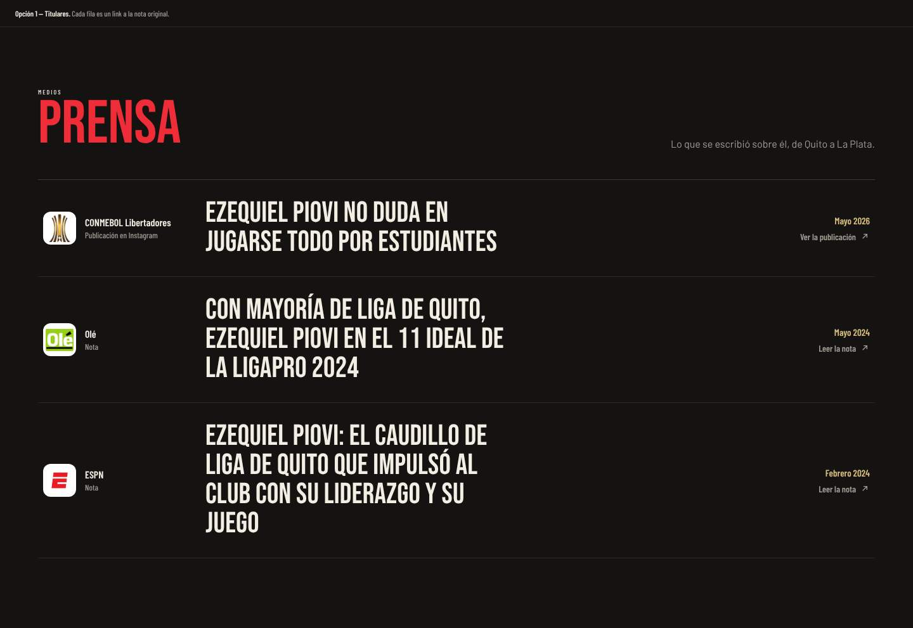
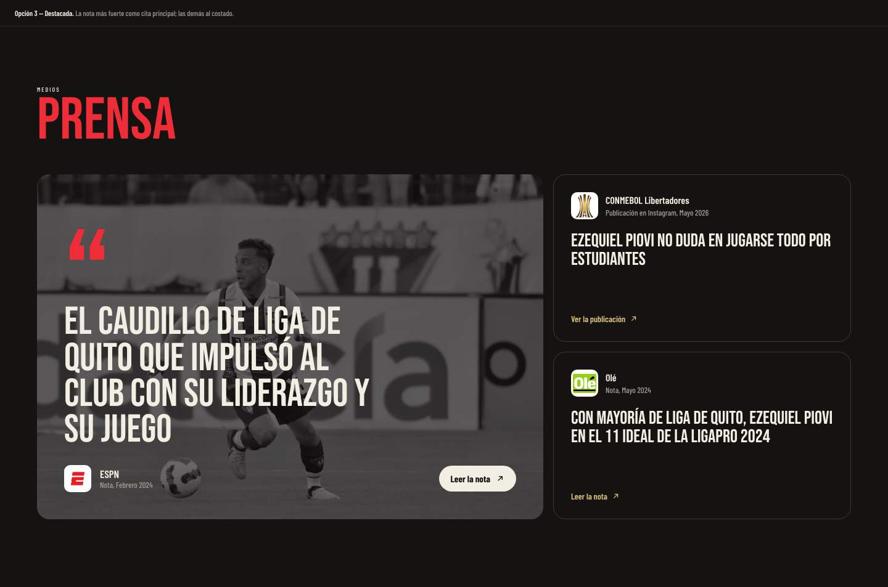

# Prensa

| # | Modelo | Estado | Preview |
|---|---|---|---|
| 1 | **Titulares** | ✅ Aplicado en Keki | [html](previews/opcion-1-titulares.html) ·  |
| 2 | Recortes | Alternativa | [html](previews/opcion-2-recortes.html) ·  |
| 3 | Destacada | Alternativa | [html](previews/opcion-3-destacada.html) ·  |
| 4 | Zócalo | Alternativa (hecho para Ivan Colman) | [html](previews/opcion-4-zocalo.html) ·  |
| 5 | Pase a pase | Alternativa (hecho para Ivan Colman) | [html](previews/opcion-5-pase.html) ·  |

Los datos están en `playerData.press`: `{ media, logo, type, title, date, url }`.

## 1. Titulares (aplicado)

**Archivo:** `src/components/Press/PressSection.jsx`. Un renglón por nota, que es un link entero, con el logo del medio, el tipo (Nota o Publicación), la fecha, el titular grande y una flecha. Al pasar el mouse el renglón se resalta. Es sobrio y se adapta a cualquier cantidad de notas.

## Alternativas

- **2. Recortes:** cada nota es un recorte de diario sobre papel crema, con cinta y borde dentado, levemente girado. Tiene mucha personalidad y funciona hasta con 3 o 4 notas.
- **3. Destacada:** la nota más fuerte va grande, con una foto en blanco y negro y la cita entre comillas. Las demás van en una columna al costado. Es el modelo para cuando hay una nota claramente mejor que el resto.

- **4. Zócalo:** cada nota como el gráfico de una transmisión de TV. Una pantalla 16:9 con una foto del jugador en blanco y negro y, encima, el zócalo: logo del medio, titular, cita y un recuadro dorado con el dato de la nota (por ejemplo, 328 pases o 31 asistencias). Debajo, un "canal" por medio para cambiar la nota (`role="tab"`). Al cambiar, el zócalo vuelve a entrar con un barrido (`clip-path`) y la foto se funde con un desenfoque leve; con teclado el cambio es inmediato. Necesita un dato y una foto por nota. En celular la foto pasa arriba y los canales se deslizan.
- **5. Pase a pase:** las notas en orden cronológico, unidas por arcos punteados como en una pizarra táctica. Al elegir una, la pelota viaja por los arcos hasta esa nota (`getPointAtLength`, ease-in-out) y la cita aparece grande debajo. Con teclado no se anima. Es el modelo para un jugador asistidor o armador, y funciona con 2 a 5 notas.
