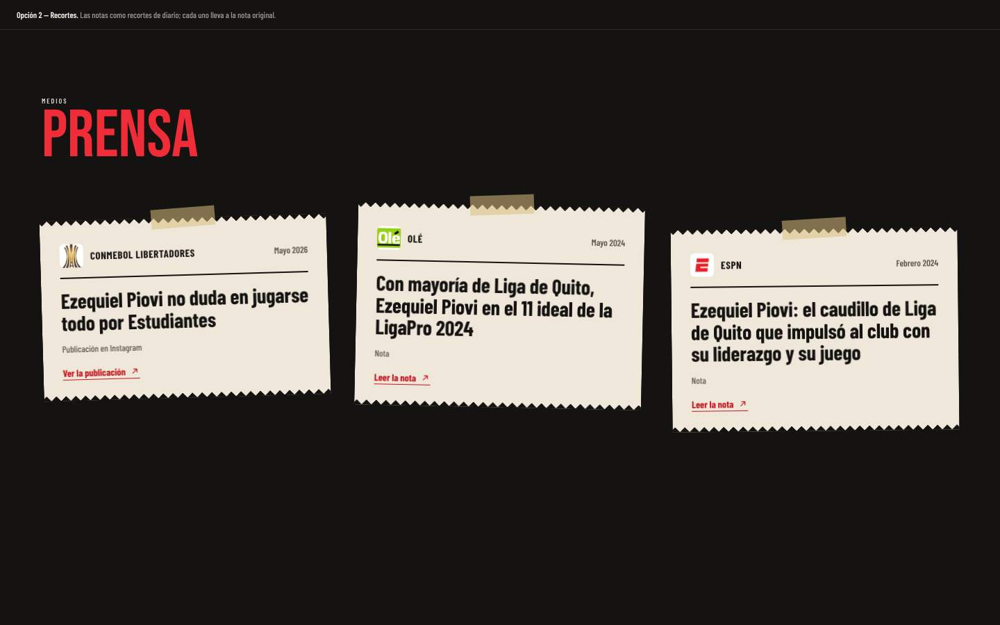
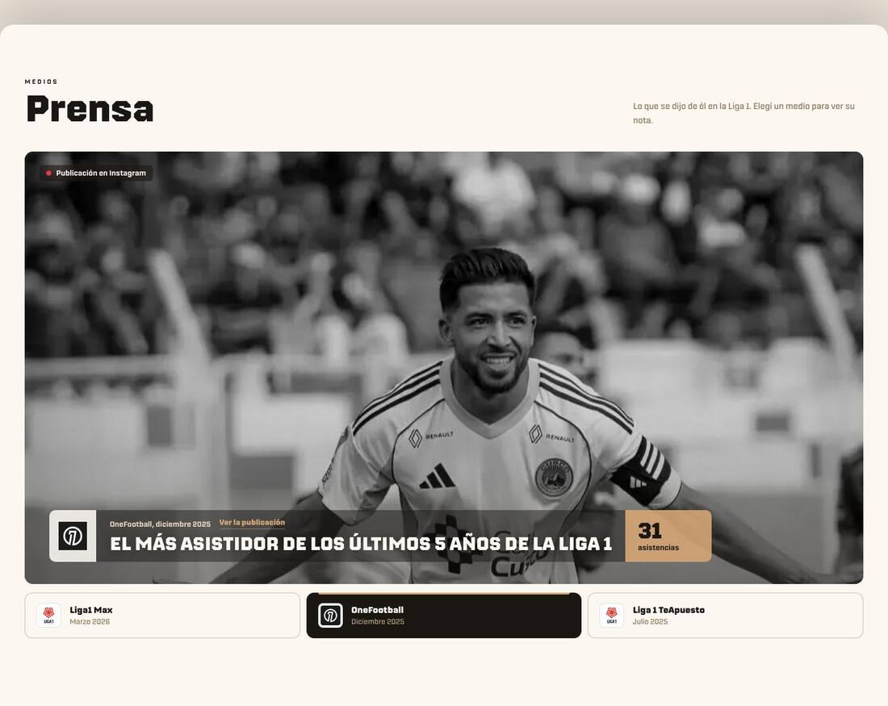
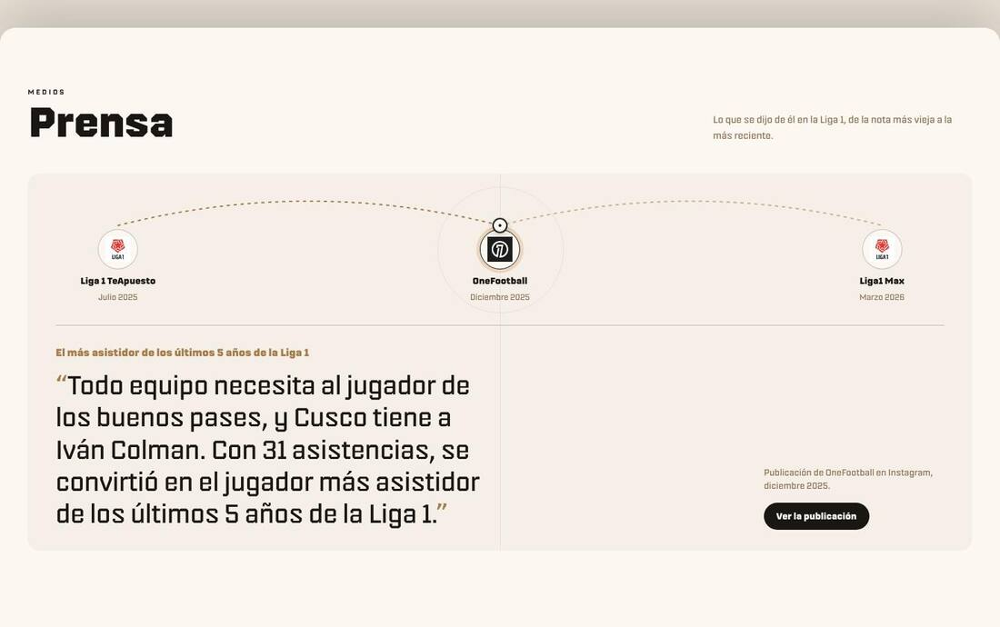
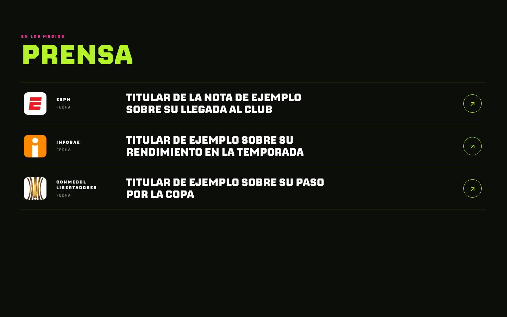
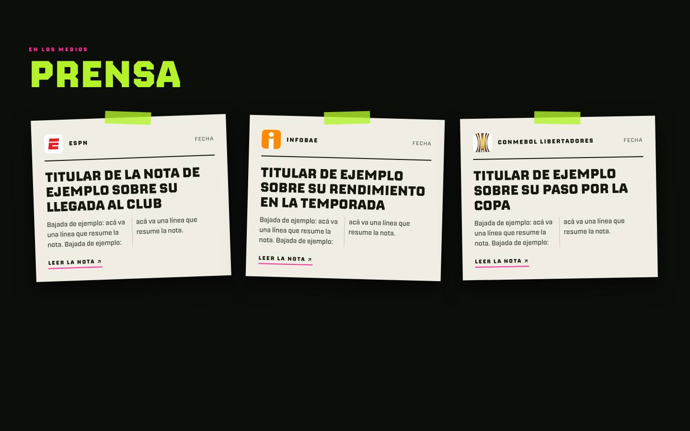
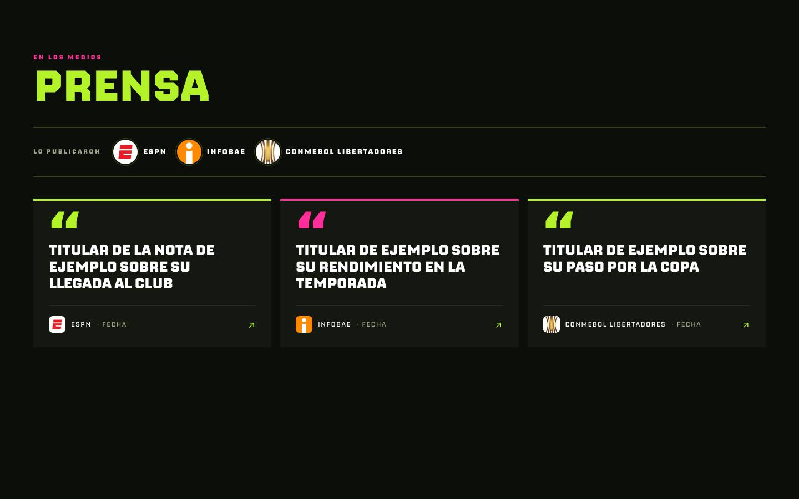
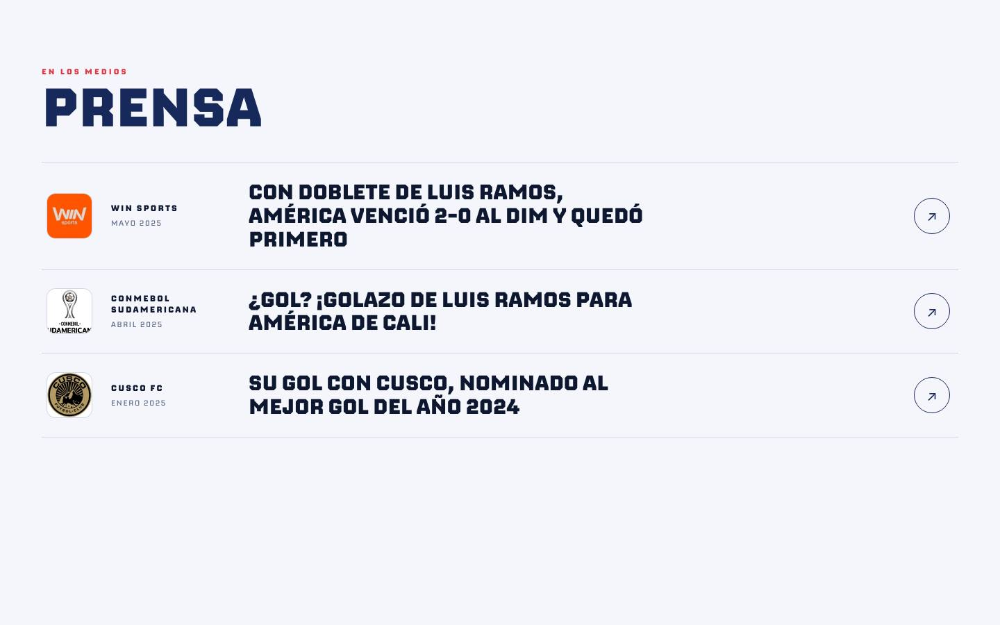
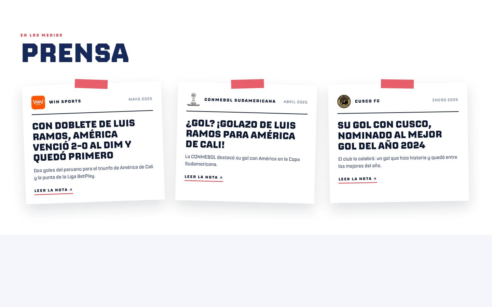
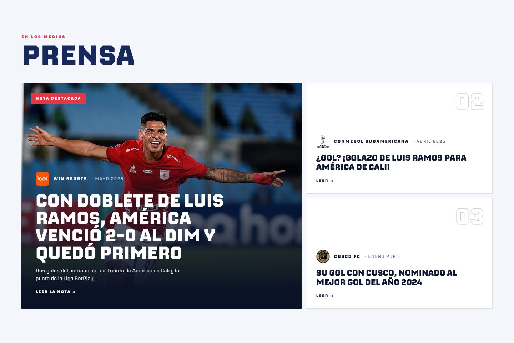
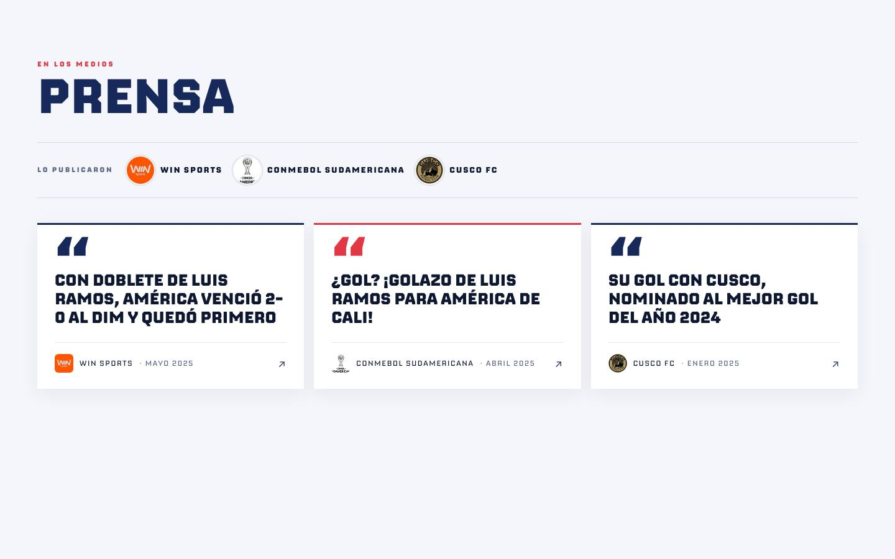

# Prensa

| # | Modelo | Estado | Preview |
|---|---|---|---|
| 1 | **Titulares** | ✅ Aplicado en Keki | [html](previews/opcion-1-titulares.html) ·  |
| 2 | Recortes | Alternativa | [html](previews/opcion-2-recortes.html) ·  |
| 3 | Destacada | Alternativa | [html](previews/opcion-3-destacada.html) ·  |
| 4 | Zócalo | Alternativa (aplicado en Ivan Colman) | [html](previews/opcion-4-zocalo.html) ·  |
| 5 | Pase a pase | Alternativa (hecho para Ivan Colman) | [html](previews/opcion-5-pase.html) ·  |

Los datos están en `playerData.press`: `{ media, logo, type, title, date, url }`.

## 1. Titulares (aplicado)

**Archivo:** `src/components/Press/PressSection.jsx`. Un renglón por nota, que es un link entero, con el logo del medio, el tipo (Nota o Publicación), la fecha, el titular grande y una flecha. Al pasar el mouse el renglón se resalta. Es sobrio y se adapta a cualquier cantidad de notas.

## Alternativas

- **2. Recortes:** cada nota es un recorte de diario sobre papel crema, con cinta y borde dentado, levemente girado. Tiene mucha personalidad y funciona hasta con 3 o 4 notas.
- **3. Destacada:** la nota más fuerte va grande, con una foto en blanco y negro y la cita entre comillas. Las demás van en una columna al costado. Es el modelo para cuando hay una nota claramente mejor que el resto.

- **4. Zócalo:** cada nota como el gráfico de una transmisión de TV. Una pantalla 16:9 con una foto del jugador en blanco y negro y, encima, un zócalo compacto y translúcido (fondo con desenfoque): logo del medio, titular y un recuadro dorado con el dato de la nota (por ejemplo, 328 pases o 31 asistencias). La cita no se muestra, para no tapar la foto. Debajo, un "canal" por medio para cambiar la nota (`role="tab"`). Al cambiar, el zócalo vuelve a entrar con un barrido (`clip-path`) y la foto se funde con un desenfoque leve; con teclado el cambio es inmediato. Necesita un dato y una foto por nota. En celular la foto pasa arriba y los canales se deslizan.
- **5. Pase a pase:** las notas en orden cronológico, unidas por arcos punteados como en una pizarra táctica. Al elegir una, la pelota viaja por los arcos hasta esa nota (`getPointAtLength`, ease-in-out) y la cita aparece grande debajo. Con teclado no se anima. Es el modelo para un jugador asistidor o armador, y funciona con 2 a 5 notas.

## Kit neón (diseñado para Héctor Fertoli)

Cuatro opciones más, en paleta oscura con acento lima y magenta y tipografía Nippo. Salen de [`kits/neon`](../../kits/neon/): los datos del jugador están en `player.js`, así que se pueden regenerar con otro jugador (ver el [README del kit](../../kits/neon/README.md)).

| # | Modelo | Estado | Preview |
|---|---|---|---|
| N1 | Titulares | Alternativa | [html](previews/neon-1-titulares.html) ·  |
| N2 | Recortes | Alternativa | [html](previews/neon-2-recortes.html) ·  |
| N3 | **Nota destacada** | Elegida en Héctor Fertoli (después se sacó la sección) | [html](previews/neon-3-destacada.html) ·  |
| N4 | Lo publicaron | Alternativa | [html](previews/neon-4-publicaron.html) ·  |

- **N1. Titulares:** lista con logo del medio, fecha, titular grande y flecha; el renglón entero se pinta del acento al pasar el mouse.
- **N2. Recortes:** cada nota como un recorte de diario pegado con cinta del acento, levemente torcido; con el mouse se endereza y sube.
- **N3. Nota destacada:** la nota más importante grande, con una foto del jugador de fondo, y las otras al costado.
  - **React:** [`react/PressDestacada.jsx`](react/PressDestacada.jsx). Lee `playerData.press` con `{ outlet, logo, title, date, summary, url }`; la primera es la destacada y usa `photo` de fondo.
- **N4. Lo publicaron:** una franja con los logos de los medios y, debajo, los titulares como citas con comillas del acento.

En el kit los titulares son de ejemplo: hay que cargar medio, titular, fecha, bajada y link reales en `press` de `player.js`.

## Kit claro (diseñado para Luis Ramos)

Las cuatro opciones del kit neón pasadas a la paleta clara (blanco azulado, azul del club y rojo), desde [`kits/claro`](../../kits/claro/). Las notas son las reales de Luis (Win Sports, CONMEBOL Sudamericana y Cusco FC).

| # | Modelo | Estado | Preview |
|---|---|---|---|
| C1 | Titulares | Alternativa | [html](previews/claro-1-titulares.html) ·  |
| C2 | Recortes | Alternativa | [html](previews/claro-2-recortes.html) ·  |
| C3 | **Nota destacada** | ✅ Aplicado en Luis Ramos (React en [`react/PressDestacadaClaro.jsx`](react/PressDestacadaClaro.jsx)) | [html](previews/claro-3-destacada.html) ·  |
| C4 | Lo publicaron | Alternativa | [html](previews/claro-4-publicaron.html) ·  |
