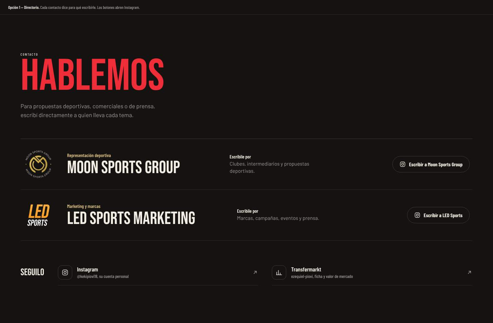
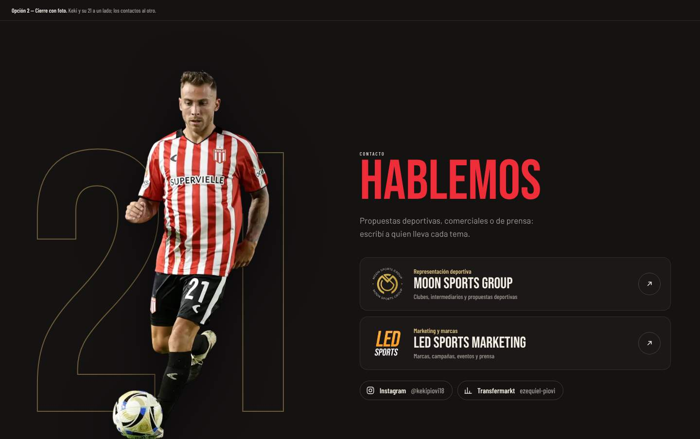
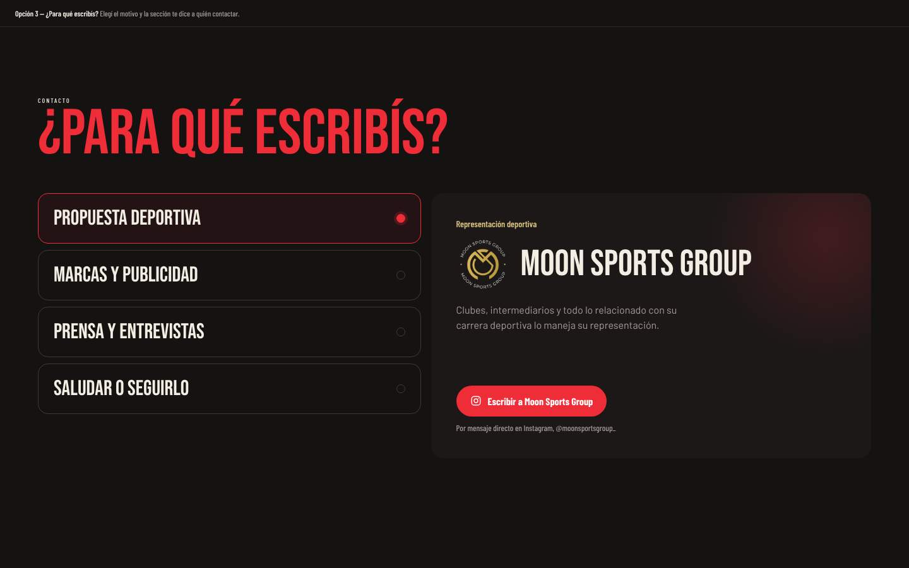
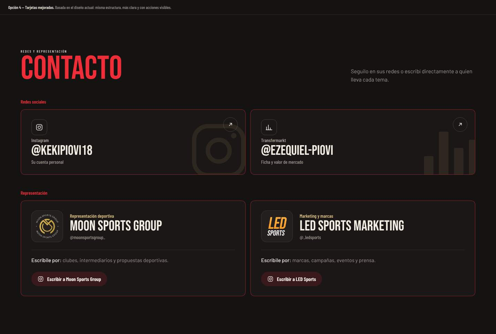

# Contacto

| # | Modelo | Estado | Preview |
|---|---|---|---|
| 1 | Directorio | Alternativa | [html](previews/opcion-1-directorio.html) ·  |
| 2 | Cierre con foto | Alternativa | [html](previews/opcion-2-cierre.html) ·  |
| 3 | ¿Para qué escribís? | Alternativa | [html](previews/opcion-3-motivo.html) ·  |
| 4 | **Tarjetas mejoradas** | ✅ Aplicado en Keki | [html](previews/opcion-4-tarjetas.html) ·  |

Los datos están en `playerData.socialMedia` (redes) y `playerData.contact` (representantes, con `title`, `label`, `image`, `handle`, `forWhom`, `cta` y `url`).

## 4. Tarjetas mejoradas (aplicado)

**Archivo:** `src/components/Contact/ContactSection.jsx`. La sección mantiene `id="contact"`.

- **Redes:** cada red es una tarjeta con su ícono grande y transparente de fondo, el usuario y una flecha. Al pasar el mouse toma el color de la red.
- **Representación:** una tarjeta por representante con logo, rol (deportiva o marketing), usuario, el texto "Escribile por…" (`forWhom`) y un botón de acción (`cta`).

## Alternativas

- **1. Directorio:** un renglón por contacto con logo, nombre, "Escribile por" y botón, más un renglón "Seguilo" con las redes. Es el más claro cuando hay muchos contactos.
- **2. Cierre con foto:** a la izquierda, el recorte del jugador con el dorsal gigante en contorno detrás. A la derecha, "Hablemos" con las tarjetas de contacto. Sirve como cierre emotivo de la página.
- **3. ¿Para qué escribís?:** el visitante elige el motivo (propuesta deportiva, marcas, prensa, saludo) y la sección le muestra a quién escribirle. Es el modelo para cuando cada tema lo lleva una persona distinta.
