# Contacto

| # | Modelo | Estado | Preview |
|---|---|---|---|
| 1 | Directorio | Alternativa | [html](previews/opcion-1-directorio.html) · 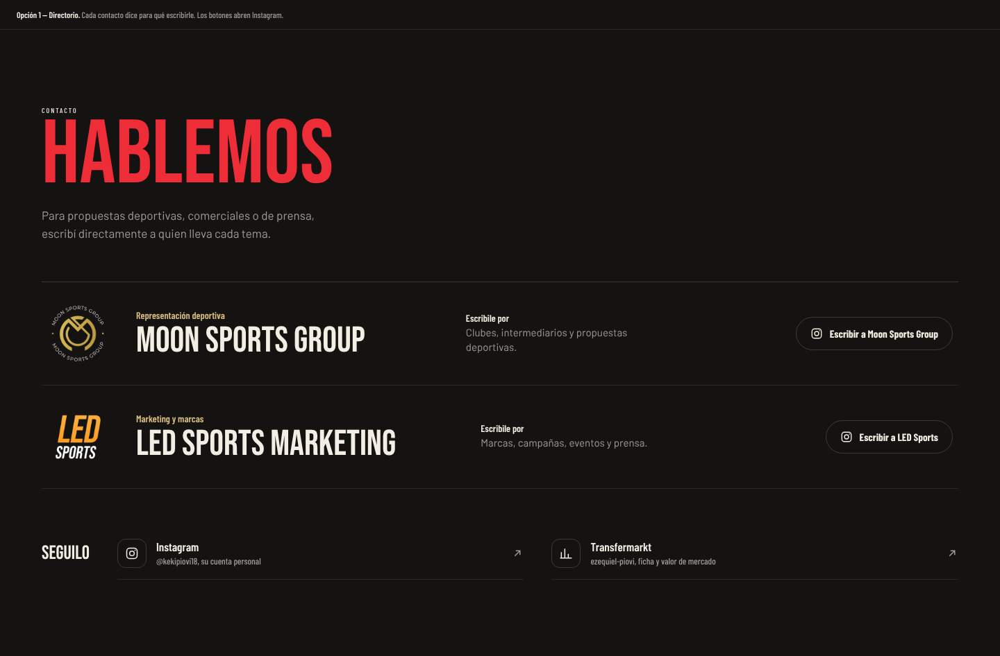 |
| 2 | Cierre con foto | Alternativa | [html](previews/opcion-2-cierre.html) · 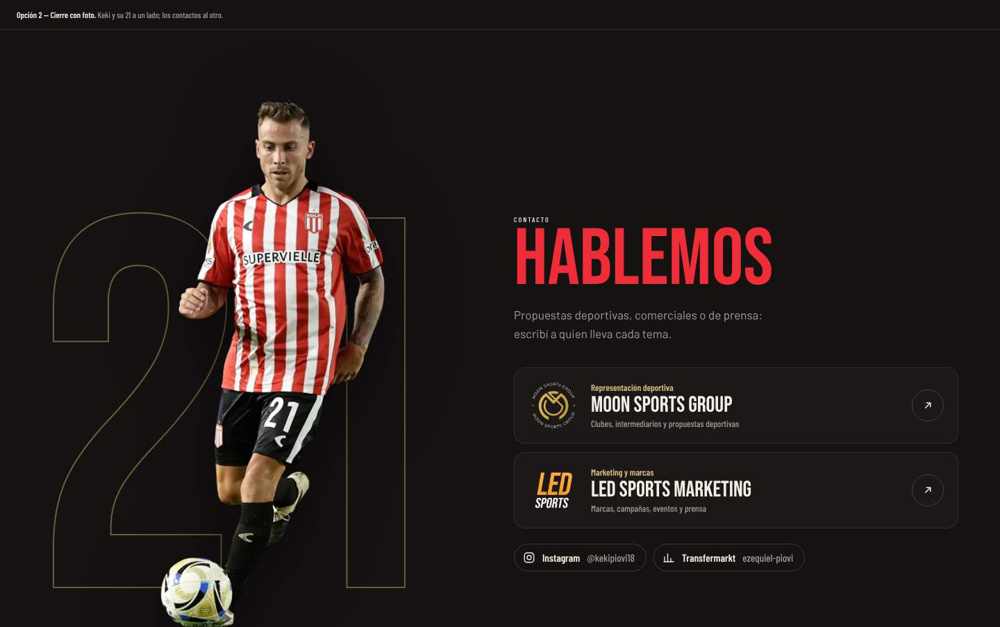 |
| 3 | ¿Para qué escribís? | Alternativa | [html](previews/opcion-3-motivo.html) · 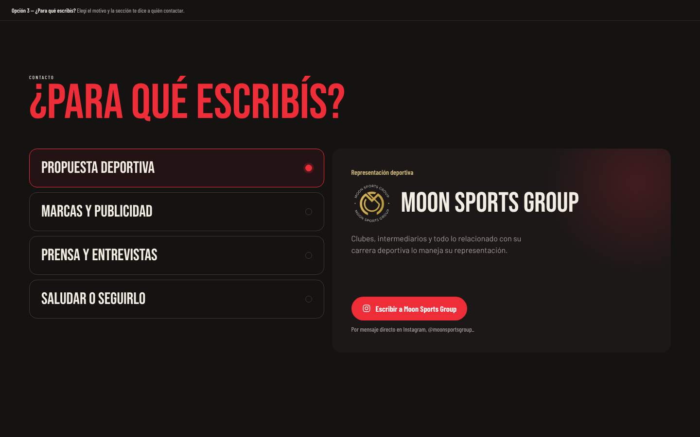 |
| 4 | **Tarjetas mejoradas** | ✅ Aplicado en Keki y en Ivan Colman (paleta clara) | [html](previews/opcion-4-tarjetas.html) · 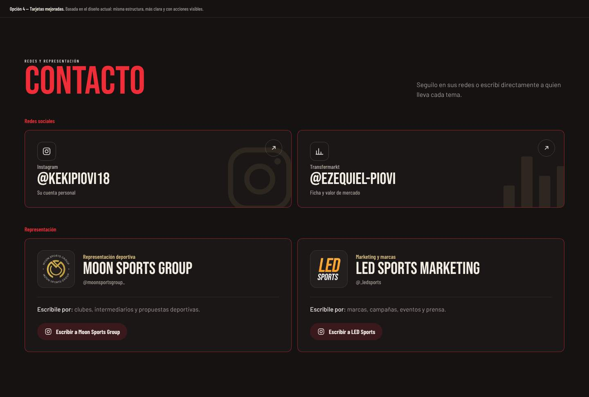 |

Los datos están en `playerData.socialMedia` (redes) y `playerData.contact` (representantes, con `title`, `label`, `image`, `handle`, `forWhom`, `cta` y `url`).

## 4. Tarjetas mejoradas (aplicado)

**Archivo:** `src/components/Contact/ContactSection.jsx`. La sección mantiene `id="contact"`.

- **Redes:** cada red es una tarjeta con su ícono grande y transparente de fondo, el usuario y una flecha. Al pasar el mouse toma el color de la red.
- **Representación:** una tarjeta por representante con logo, rol (deportiva o marketing), usuario, el texto "Escribile por…" (`forWhom`) y un botón de acción (`cta`).

## Alternativas

- **1. Directorio:** un renglón por contacto con logo, nombre, "Escribile por" y botón, más un renglón "Seguilo" con las redes. Es el más claro cuando hay muchos contactos.
- **2. Cierre con foto:** a la izquierda, el recorte del jugador con el dorsal gigante en contorno detrás. A la derecha, "Hablemos" con las tarjetas de contacto. Sirve como cierre emotivo de la página.
- **3. ¿Para qué escribís?:** el visitante elige el motivo (propuesta deportiva, marcas, prensa, saludo) y la sección le muestra a quién escribirle. Es el modelo para cuando cada tema lo lleva una persona distinta.

## Kit neón (diseñado para Héctor Fertoli)

Cuatro opciones más, en paleta oscura con acento lima y magenta y tipografía Nippo. Salen de [`kits/neon`](../../kits/neon/): los datos del jugador están en `player.js`, así que se pueden regenerar con otro jugador (ver el [README del kit](../../kits/neon/README.md)).

| # | Modelo | Estado | Preview |
|---|---|---|---|
| N1 | Directorio | Alternativa | [html](previews/neon-1-directorio.html) · 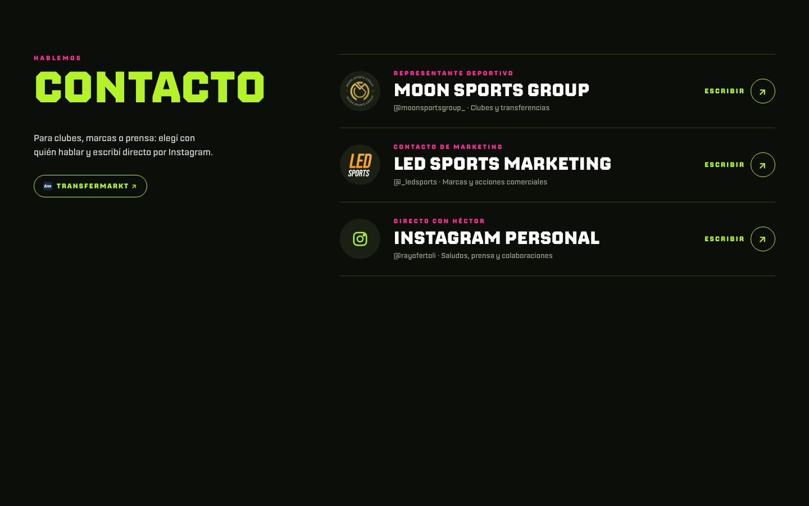 |
| N2 | Cierre con foto | Alternativa | [html](previews/neon-2-cierre.html) · 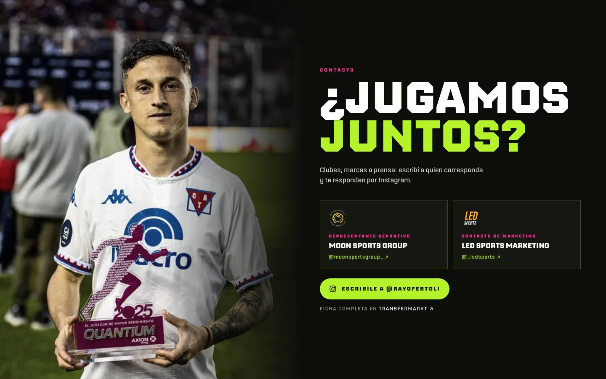 |
| N3 | ¿Para qué escribís? | Alternativa | [html](previews/neon-3-motivo.html) · 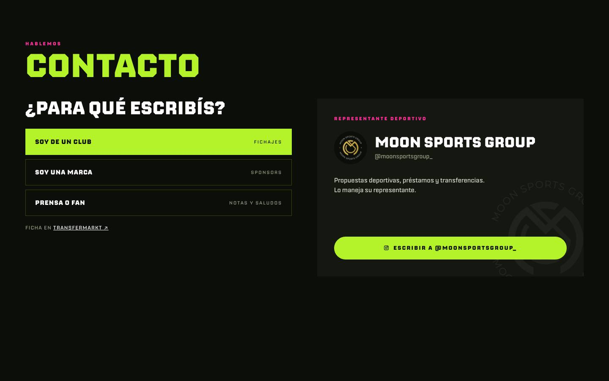 |
| N4 | **Tarjetas grandes** | ✅ Aplicado en Héctor Fertoli | [html](previews/neon-4-tarjetas.html) · 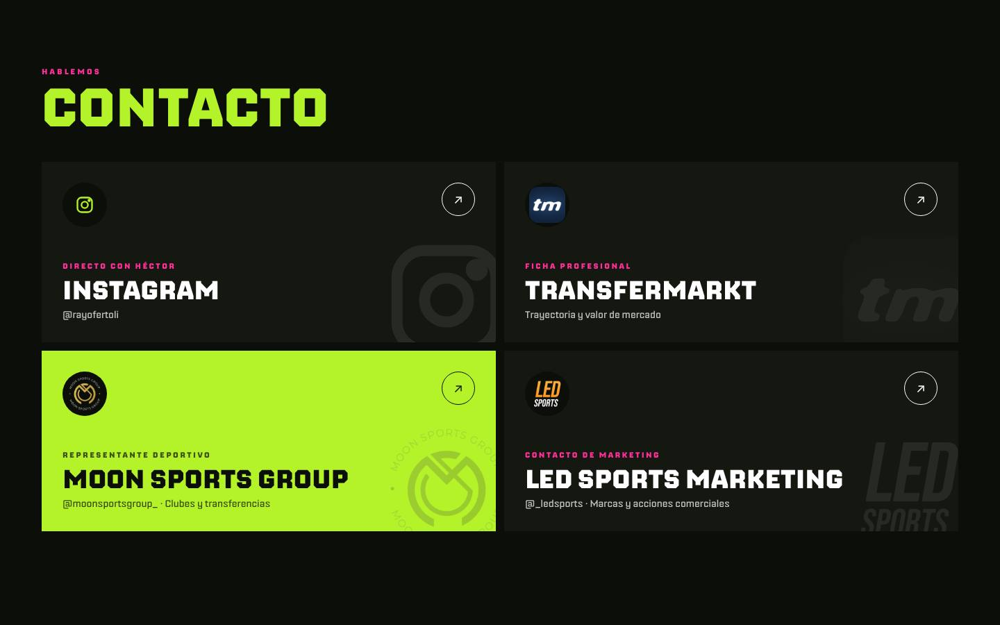 |

- **N1. Directorio:** título a la izquierda y un renglón por contacto (representante, marketing e Instagram personal) con rol y para qué escribirle.
- **N2. Cierre con foto:** media pantalla con una foto y del otro lado "¿Jugamos juntos?" con las agencias y un botón grande a Instagram.
- **N3. ¿Para qué escribís?:** el visitante elige si es de un club, una marca o prensa/fan, y la tarjeta le muestra a quién escribirle (representante, agencia de marketing o Instagram).
- **N4. Tarjetas grandes (aplicado en Fertoli):** cuatro tarjetas 2×2: Instagram y Transfermarkt arriba, el representante en el acento y marketing abajo. Cada una tiene el logo en gris y tenue de fondo, y toda la tarjeta es el link.
  - **React:** [`react/ContactTarjetasNeon.jsx`](react/ContactTarjetasNeon.jsx). Lee `socialMedia` y `contact` como el starter.

## Kit claro (diseñado para Luis Ramos)

Opciones en paleta clara (blanco azulado, azul del club y rojo) con tipografía Nippo, desde [`kits/claro`](../../kits/claro/). Los datos salen de `kits/claro/player.js`.

| # | Modelo | Estado | Preview |
|---|---|---|---|
| C1 | Directorio | Alternativa | [html](previews/claro-1-directorio.html) · 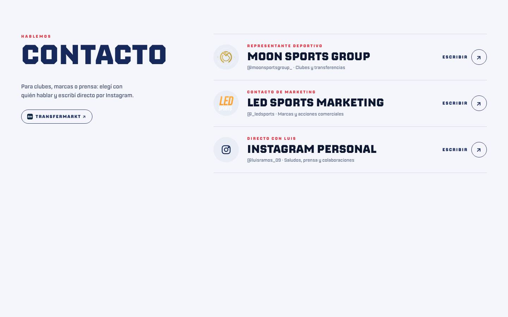 |
| C2 | Cierre con foto | Alternativa | [html](previews/claro-2-cierre.html) · 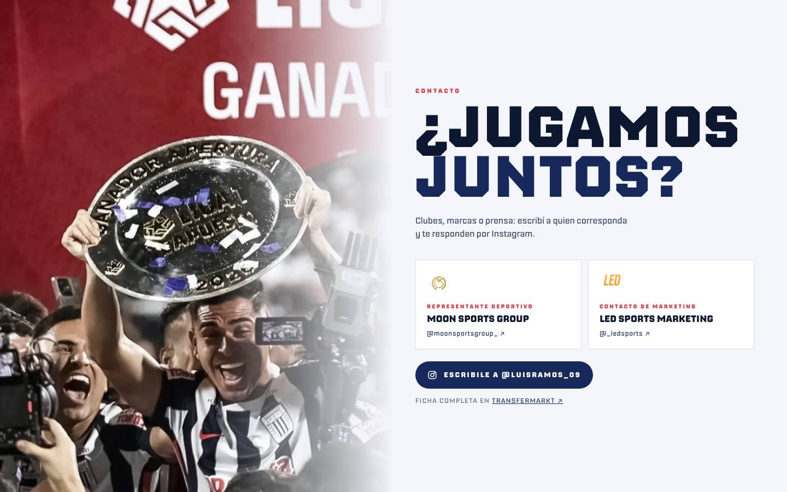 |
| C3 | ¿Para qué escribís? | Alternativa | [html](previews/claro-3-motivo.html) · 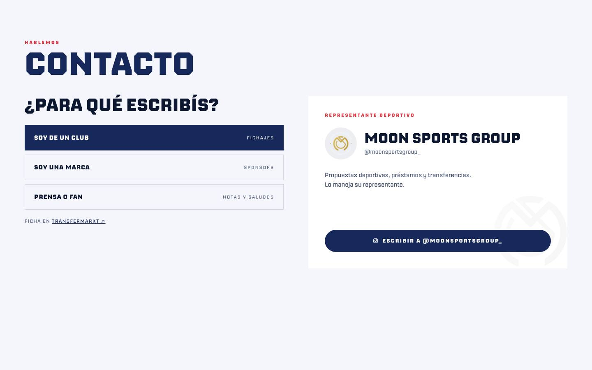 |
| C4 | **Tarjetas grandes** | ✅ Aplicado en Luis Ramos | [html](previews/claro-4-tarjetas.html) · 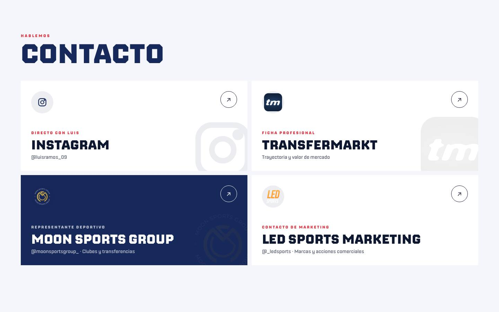 |

- **C1. Directorio:** Título a la izquierda y un renglón por contacto: Moon Sports, LED Sports e Instagram, con para qué escribirle a cada uno.
- **C2. Cierre con foto:** Media pantalla con la foto del título y del otro lado "¿Jugamos juntos?" con las agencias y un botón grande a Instagram.
- **C3. ¿Para qué escribís?:** El visitante elige si es de un club, una marca o prensa/fan, y la tarjeta le muestra a quién escribirle.
- **C4. Tarjetas grandes (aplicado en Luis Ramos):** Cuatro tarjetas 2x2 (Instagram, Transfermarkt, representante en azul y marketing) con el logo en gris de fondo.
  - **React:** [`react/ContactTarjetasClaro.jsx`](react/ContactTarjetasClaro.jsx).
