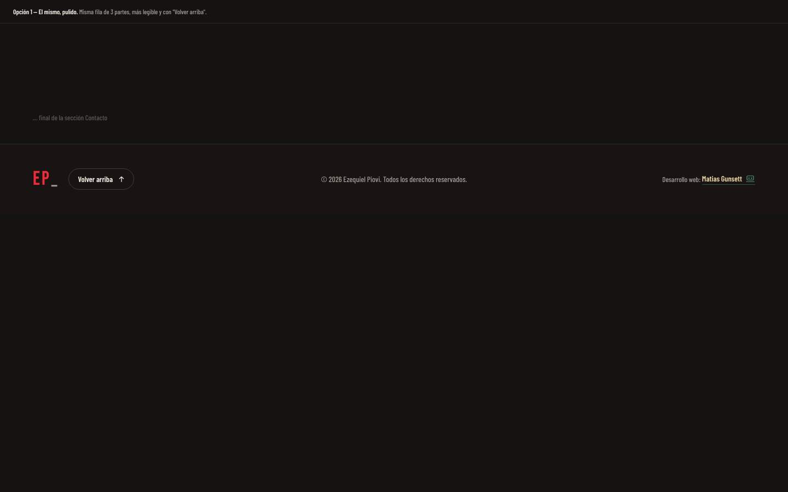
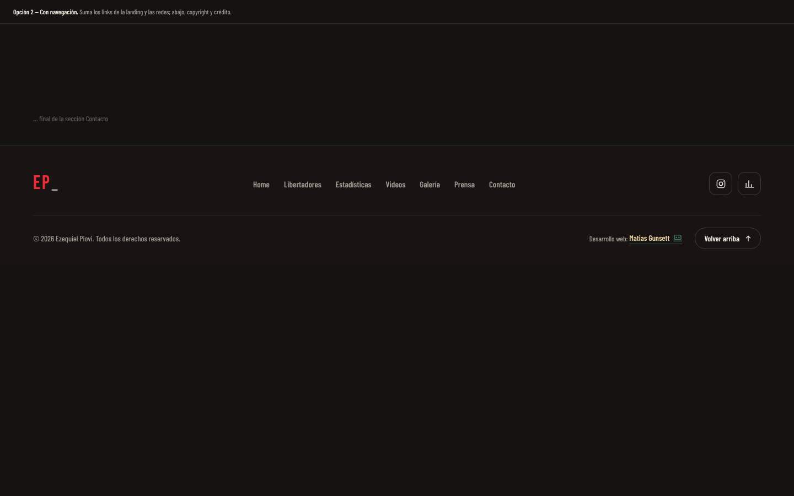
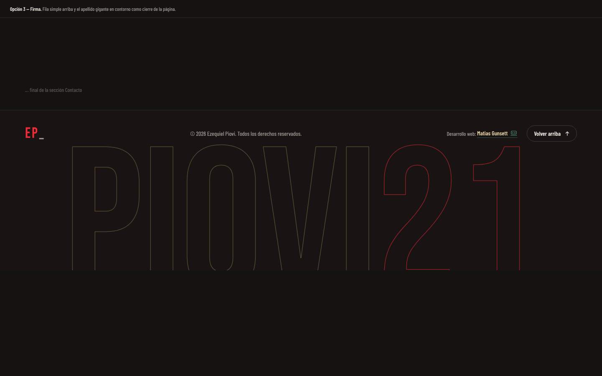
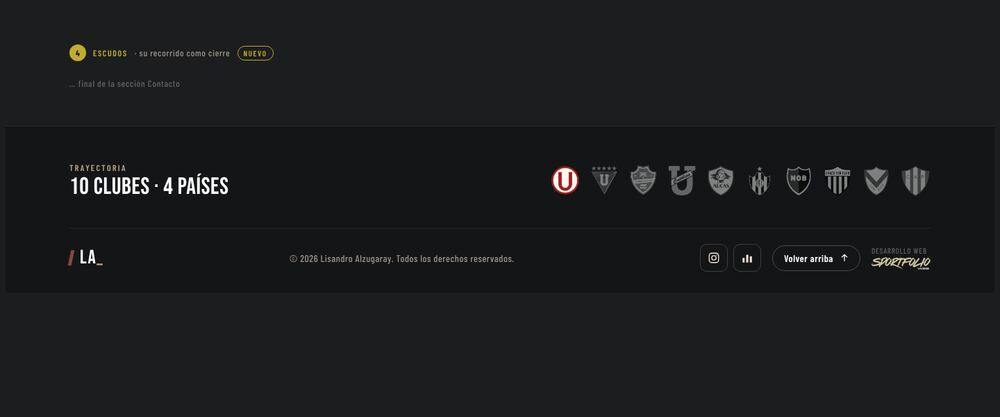
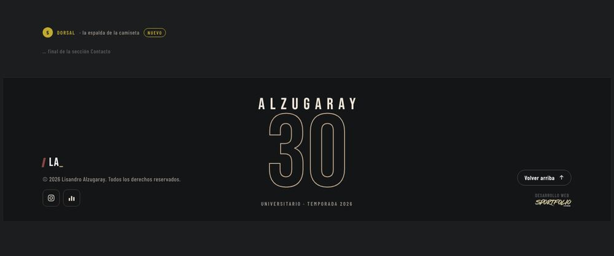

# Footer

| # | Modelo | Estado | Preview |
|---|---|---|---|
| 1 | **El mismo, pulido** | ✅ Aplicado en Keki (con cambios) | [html](previews/opcion-1-pulido.html) ·  |
| 2 | Con navegación | Alternativa | [html](previews/opcion-2-navegacion.html) ·  |
| 3 | Firma | Alternativa | [html](previews/opcion-3-firma.html) ·  |
| 4 | Escudos | Alternativa | [html](previews/opcion-4-escudos.html) ·  |
| 5 | Dorsal | Alternativa | [html](previews/opcion-5-dorsal.html) ·  |

## 1. Pulido (aplicado)

**Archivos:** `src/components/UI/Footer.jsx` y `BrandLogo.jsx`.

- **A la izquierda:** el mismo logo del navbar (`BrandLogo`: barra inclinada, iniciales y guion bajo), que lleva arriba de todo. En la preview eran iniciales sueltas, y en Keki se cambió por este logo.
- **En el centro:** "© {año} Nombre Apellido. Todos los derechos reservados." El nombre sale de `displayName`, con mayúscula inicial.
- **A la derecha:** "Volver arriba" queda **encima** del crédito "Desarrollo web: Matias Gunsett". También fue un cambio pedido en Keki. El crédito usa los colores `dev.*`, con el texto en crema y el subrayado en verde. El link del crédito no se toca.

## Alternativas

- **2. Con navegación:** logo, links a todas las secciones e íconos de redes en una fila; debajo, el copyright, el crédito y "Volver arriba".
- **3. Firma:** una fila simple y, debajo, el apellido gigante en contorno como cierre visual de la página.
- **4. Escudos:** arriba, "Trayectoria · N clubes · N países" y la fila de escudos del actual al primero (sale de `career` y `clubs`). El actual va a color y el resto en gris, que se colorea al pasar el mouse. Debajo, logo, copyright, redes, "Volver arriba" y el crédito. Conviene para jugadores con mucho recorrido.
- **5. Dorsal:** al centro, la espalda de la camiseta en tipografía: el apellido espaciado arriba del dorsal gigante en contorno y el club con la temporada debajo. A los costados, logo, copyright y redes a la izquierda, y "Volver arriba" con el crédito a la derecha. En mobile el dorsal va primero.
