# Footer

| # | Modelo | Estado | Preview |
|---|---|---|---|
| 1 | **El mismo, pulido** | ✅ Aplicado en Keki (con cambios) | [html](previews/opcion-1-pulido.html) · 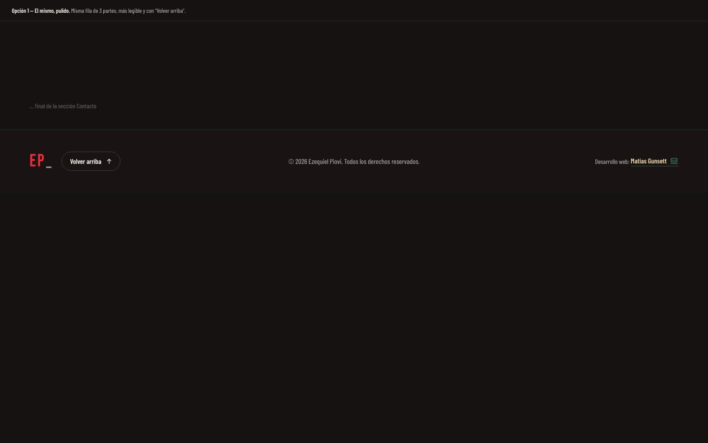 |
| 2 | Con navegación | Alternativa | [html](previews/opcion-2-navegacion.html) · 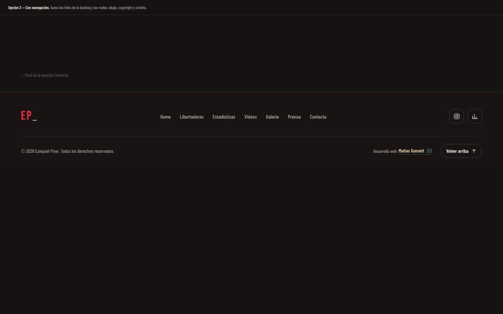 |
| 3 | Firma | Alternativa (aplicado en Ivan Colman) | [html](previews/opcion-3-firma.html) · 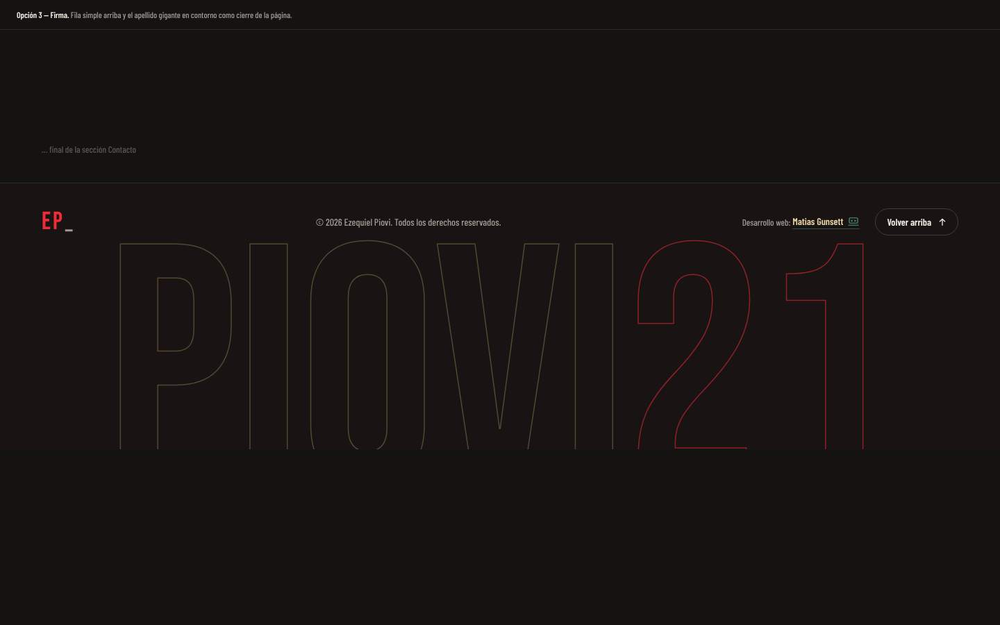 |

## 1. Pulido (aplicado)

**Archivos:** `src/components/UI/Footer.jsx` y `BrandLogo.jsx`.

- **A la izquierda:** el mismo logo del navbar (`BrandLogo`: barra inclinada, iniciales y guion bajo), que lleva arriba de todo. En la preview eran iniciales sueltas, y en Keki se cambió por este logo.
- **En el centro:** "© {año} Nombre Apellido. Todos los derechos reservados." El nombre sale de `displayName`, con mayúscula inicial.
- **A la derecha:** "Volver arriba" queda **encima** del crédito "Desarrollo web: Matias Gunsett". También fue un cambio pedido en Keki. El crédito usa los colores `dev.*`, con el texto en crema y el subrayado en verde. El link del crédito no se toca.

## Alternativas

- **2. Con navegación:** logo, links a todas las secciones e íconos de redes en una fila; debajo, el copyright, el crédito y "Volver arriba".
- **3. Firma:** una fila simple y, debajo, el apellido gigante en contorno como cierre visual de la página.

## Crédito en fondos claros

El logo de Sportfolio (`starter/assets/logo_sport.png`) es crema y blanco: sobre un footer claro no se ve. Para paletas claras usar `starter/assets/logo_sport_dark.webp`, en verde `dev.green`, con el mismo link (`https://matiasgunsett.netlify.app/sportfolio`). Así quedó en Ivan Colman, junto al modelo Firma: la firma ajusta su tamaño al ancho con un `ResizeObserver`.

## Kit neón (diseñado para Héctor Fertoli)

Cuatro opciones más, en paleta oscura con acento lima y magenta y tipografía Nippo. Salen de [`kits/neon`](../../kits/neon/): los datos del jugador están en `player.js`, así que se pueden regenerar con otro jugador (ver el [README del kit](../../kits/neon/README.md)).

| # | Modelo | Estado | Preview |
|---|---|---|---|
| N1 | Pulido | Alternativa | [html](previews/neon-1-pulido.html) · 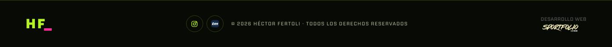 |
| N2 | Con navegación | Alternativa | [html](previews/neon-2-navegacion.html) · 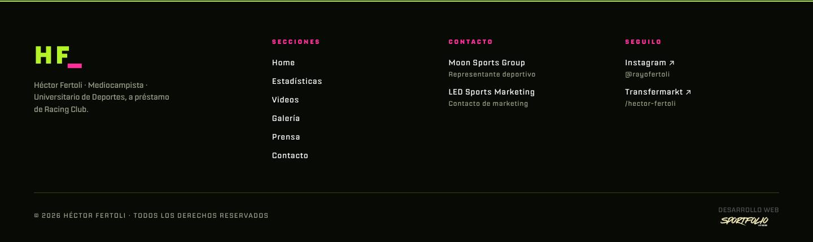 |
| N3 | **Firma** | ✅ Aplicado en Héctor Fertoli | [html](previews/neon-3-firma.html) · 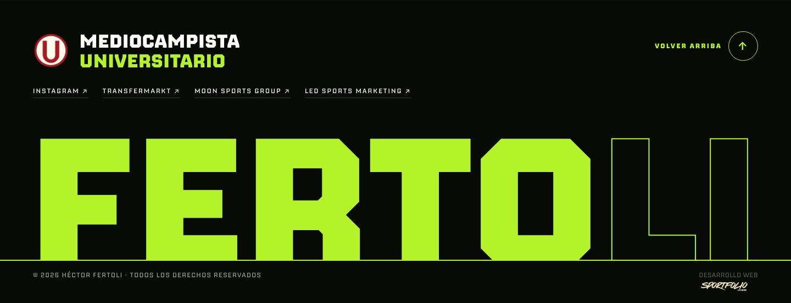 |
| N4 | Escudos | Alternativa | [html](previews/neon-4-escudos.html) · 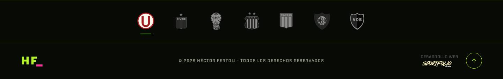 |

- **N1. Pulido:** una sola línea: iniciales, redes, derechos y el crédito de desarrollo.
- **N2. Con navegación:** columnas con logo y bajada, secciones de la página, contactos y redes.
- **N3. Firma (aplicado en Fertoli):** escudo del club con la posición y el club al lado, links, "Volver arriba" y el apellido gigante a todo el ancho (las dos últimas letras en contorno). El tamaño de la palabra se ajusta a la cantidad de letras.
  - **React:** [`react/FooterFirma.jsx`](react/FooterFirma.jsx). Lee `displayName`, `fullName`, `position`, `currentClub`, `logoCurrentClub`, `socialMedia` y `contact`.
- **N4. Escudos:** una franja con los escudos de todos sus clubes en gris (el actual a color y subrayado) y debajo logo, derechos, crédito y "Volver arriba".

En las cuatro el crédito es el logo de Sportfolio con el link a matiasgunsett.netlify.app/sportfolio, igual que en todas las landings.

## Kit claro (diseñado para Luis Ramos)

Opciones en paleta clara (blanco azulado, azul del club y rojo) con tipografía Nippo, desde [`kits/claro`](../../kits/claro/). Los datos salen de `kits/claro/player.js`.

| # | Modelo | Estado | Preview |
|---|---|---|---|
| C1 | Pulido | Alternativa | [html](previews/claro-1-pulido.html) · 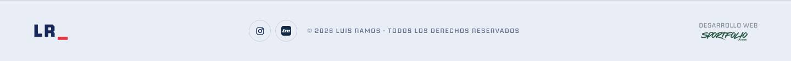 |
| C2 | Con navegación | Alternativa | [html](previews/claro-2-navegacion.html) · 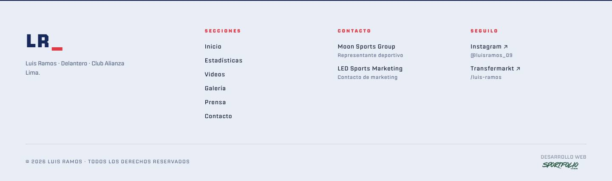 |
| C3 | **Firma** | ✅ Aplicado en Luis Ramos | [html](previews/claro-3-firma.html) · 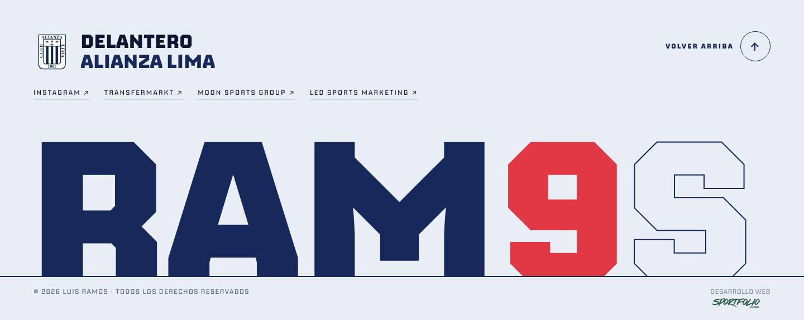 |
| C4 | Escudos | Alternativa | [html](previews/claro-4-escudos.html) · 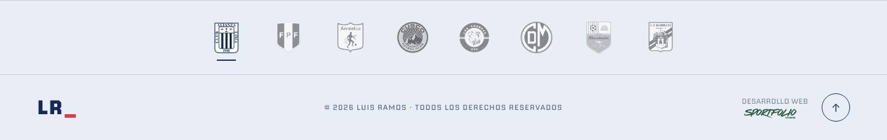 |

- **C1. Pulido:** Una sola línea: logo, redes, derechos y el crédito de desarrollo.
- **C2. Con navegación:** Columnas con logo y bajada, secciones, contactos y redes.
- **C3. Firma (aplicado en Luis Ramos):** Escudo, posición y club, links, Volver arriba y la firma RAM9S gigante a todo el ancho, con el dorsal en rojo en lugar de la O.
  - **React:** [`react/FooterFirmaClaro.jsx`](react/FooterFirmaClaro.jsx).
- **C4. Escudos:** Franja con los escudos de sus 8 clubes en gris (Alianza a color) y debajo logo, derechos, crédito y Volver arriba.

La firma cambia la primera "O" del apellido por el dorsal en rojo (RAM9S). Si el apellido no tiene O, el dorsal va al final. El tamaño se ajusta midiendo el texto real.

## Kit azul (diseñado para Ronaldo Martínez)

Opciones en paleta oscura azul (fondo `#050B14`, azul Vélez `#4D93D6` y dorado `#D4A84B`) con tipografía Nippo, desde [`kits/azul`](../../kits/azul/). Los datos salen de `kits/azul/player.js`. En React se portaron con Bebas Neue, Barlow Condensed y Barlow, como el resto del starter.

| # | Modelo | Estado | Preview |
|---|---|---|---|
| A3 | **Firma** | ✅ Aplicado en Ronaldo Martínez | [html](previews/azul-3-firma.html) · 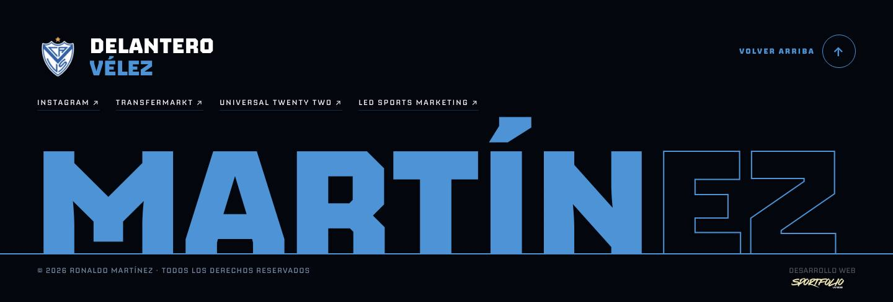 |

- **A3. Firma (aplicado en Ronaldo Martínez):** escudo con posición y club, botón "Volver arriba", links a redes y contactos, y la firma gigante a todo el ancho con los dos últimos caracteres en contorno (en Ronaldo, `ronaldo77`). Abajo, derechos y crédito de Sportfolio.
  - **React:** [`react/FooterFirmaAzul.jsx`](react/FooterFirmaAzul.jsx). La firma es la constante `SIGNATURE`; un `ResizeObserver` ajusta el tamaño de letra para que ocupe justo el ancho. La entrada usa `IntersectionObserver` y no ScrollTrigger, porque el footer es lo último y su posición cambia cuando cargan las secciones de arriba.
