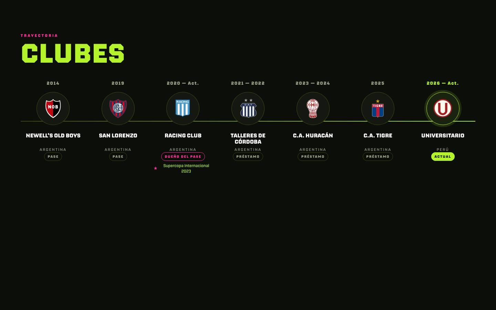
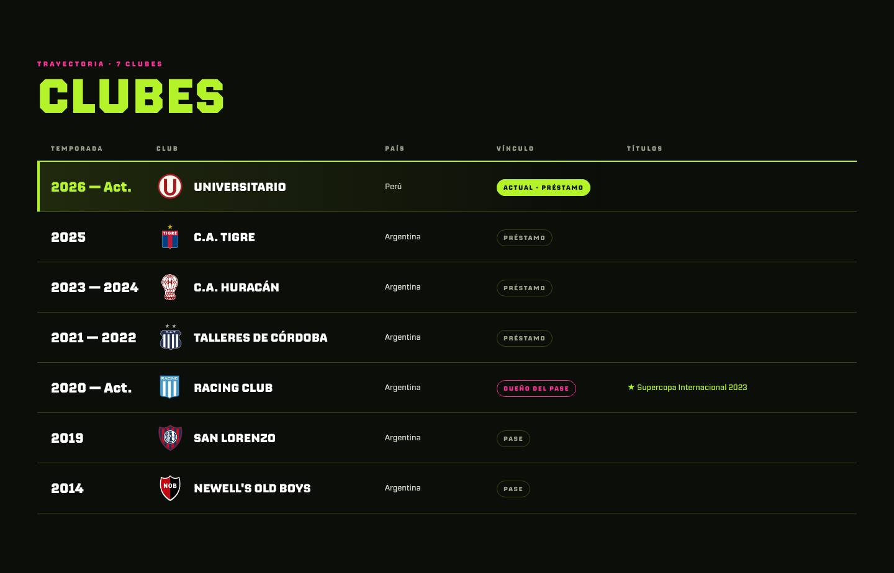
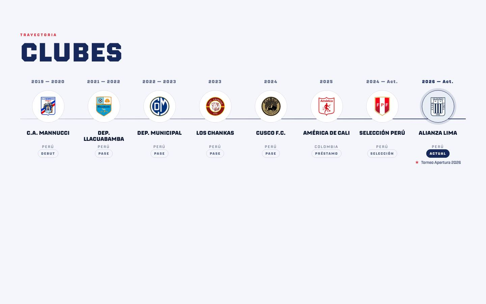
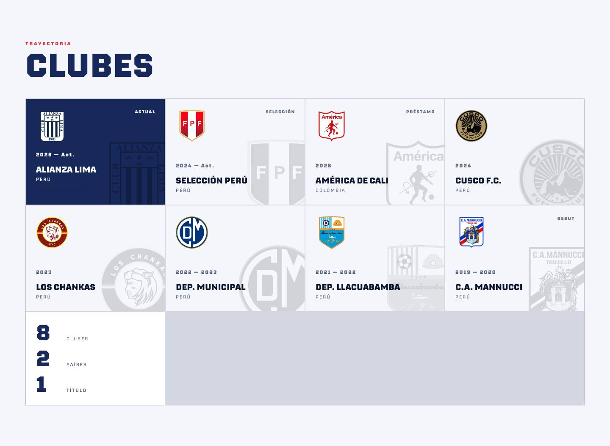
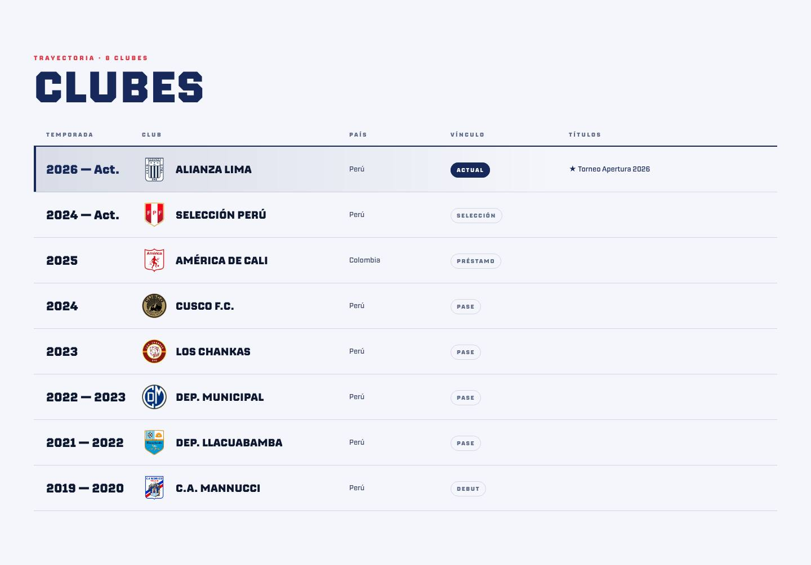
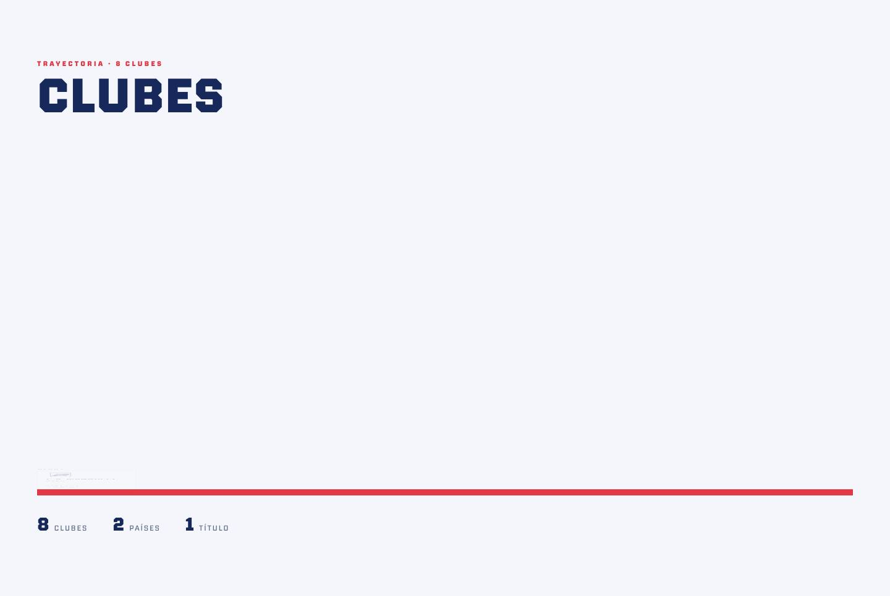
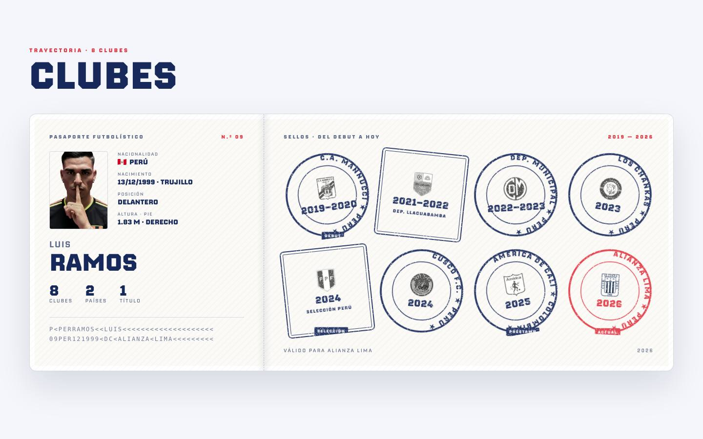

# Clubes (trayectoria)

En Keki los clubes van dentro de Estadísticas (renglones que se abren, ver [`03-estadisticas`](../03-estadisticas/)) y en Ivan Colman como tarjetas horizontales (Estadísticas opción 4). Esta carpeta junta los modelos de trayectoria como **sección propia**, todos del kit neón (diseñados para Héctor Fertoli).

| # | Modelo | Estado | Preview |
|---|---|---|---|
| N1 | Línea de tiempo | Alternativa | [html](previews/neon-1-linea.html) ·  |
| N2 | **Grilla de escudos** | ✅ Aplicado en Héctor Fertoli | [html](previews/neon-2-grilla.html) ·  |
| N3 | Planilla | Alternativa | [html](previews/neon-3-planilla.html) ·  |
| N4 | Árbol de pases | Alternativa | [html](previews/neon-4-arbol.html) ·  |

Los datos salen de `clubs` en `kits/neon/player.js` (del más reciente al más antiguo): `n` nombre, `c` país, `y` años, `y0` año de llegada, `l` escudo, `t` títulos, `i` vínculo (`'Préstamo'`, `'Pase'` o vacío), `cur` club actual y `own` dueño del pase.

## N2. Grilla de escudos (aplicado en Fertoli)

**React:** [`react/ClubsGrid.jsx`](react/ClubsGrid.jsx). En el proyecto se monta dentro de `StatsSection.jsx` con `CLUBS_DESIGN = 'grilla'` y lee `playerData.clubs` (`name`, `country`, `years`, `logo`, `titles`, `info`).

- Una baldosa por club, del actual al más antiguo, con el escudo, los años, el país y el vínculo arriba a la derecha.
- De fondo, el **escudo completo en escala de grises y tenue** (no una silueta ni el año: así lo pidió el usuario). En la baldosa del club actual, que va en el acento, el escudo de fondo va oscuro.
- La última baldosa resume clubes, países y títulos ("Título" en singular si hay uno).
- Hover solo con mouse: la baldosa se ilumina y el escudo crece. 4 columnas en desktop, 2 en tablet y mobile.

## Alternativas

- **N1. Línea de tiempo:** los clubes del más antiguo al actual sobre una línea que se ilumina hacia el presente. Cada parada con escudo, años, país y una etiqueta (Actual, Dueño del pase, Préstamo o Pase); los títulos con estrella. En mobile la línea pasa a vertical.
- **N3. Planilla:** una tabla tipo ficha de transferencias: temporada, club, país, vínculo y títulos. El club actual marcado con una barra del acento. En mobile, renglones compactos con escudo, club y vínculo.
- **N4. Árbol de pases:** explica por qué un jugador figura en un club y juega en otro: los inicios a la izquierda, el club **dueño del pase** en el centro (con borde magenta) y, desde ahí, los préstamos hasta el club actual. Líneas continuas para pases y punteadas para préstamos. Necesita un club con `own: true`.

## Kit claro (diseñado para Luis Ramos)

Opciones en paleta clara (blanco azulado, azul del club y rojo) con tipografía Nippo, desde [`kits/claro`](../../kits/claro/). Los datos salen de `kits/claro/player.js`.

| # | Modelo | Estado | Preview |
|---|---|---|---|
| C1 | Línea de tiempo | Alternativa | [html](previews/claro-1-linea.html) ·  |
| C2 | **Grilla de escudos** | ✅ Aplicado en Luis Ramos | [html](previews/claro-2-grilla.html) ·  |
| C3 | Planilla | Alternativa | [html](previews/claro-3-planilla.html) ·  |
| C4 | Escalera | Alternativa | [html](previews/claro-4-escalera.html) ·  |
| C5 | Pasaporte | Alternativa | [html](previews/claro-5-pasaporte.html) ·  |

- **C1. Línea de tiempo:** Los 8 clubes del debut en Mannucci a Alianza Lima sobre una línea. Cada parada con escudo, años, país y vínculo; el actual destacado con su título.
- **C2. Grilla de escudos (aplicado en Luis Ramos):** Una baldosa por club con el escudo grande en gris de fondo. Alianza en azul y una baldosa final con clubes, países y títulos.
  - **React:** [`react/ClubsGridClaro.jsx`](react/ClubsGridClaro.jsx).
- **C3. Planilla:** Tabla tipo ficha de transferencias: temporada, club, país, vínculo (préstamo, selección, debut) y títulos. El club actual marcado con una barra.
- **C4. Escalera:** Nuevo: cada club es un escalón que sube del debut al club actual, con el año en contorno. Alianza arriba de todo, en azul, con el título. En mobile, una escalera de tarjetas.
- **C5. Pasaporte:** La carrera como un pasaporte abierto: a la izquierda la hoja de datos (foto, nacionalidad, nacimiento, posición, clubes, países y títulos, con el renglón de máquina al pie) y a la derecha un sello por club, del debut a Alianza Lima.

En React va dentro de `StatsSection.jsx` con `CLUBS_DESIGN = 'grilla'`. La etiqueta de cada baldosa sale de `club.info` (Préstamo, Debut) o del nombre (Selección).
